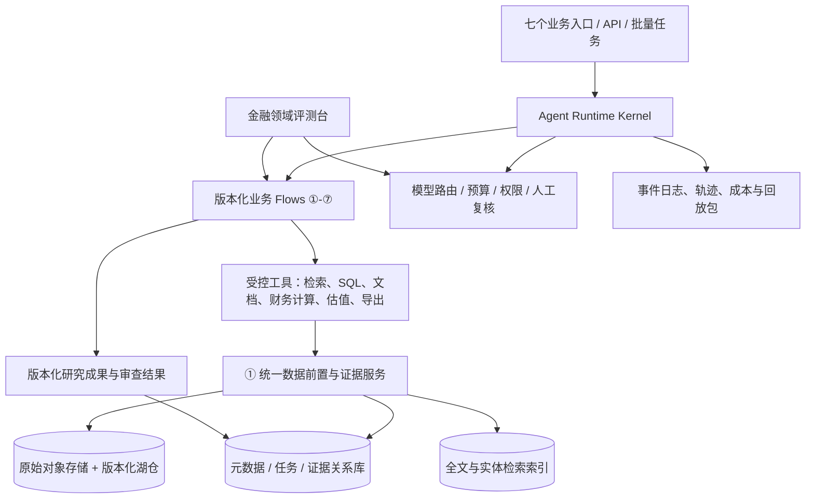

# 七赛题统一金融投研 Agent 平台架构设计（v0.1）

## 0. 决策摘要

建设一个平台、七个可独立启动的业务 flow，而不是七个互不相通的聊天机器人。所有新材料和已有数据先经统一的数据登记、解析或复用校验，形成带来源、时点、口径和版本的证据对象，再由专业业务处理。确定性计算由代码执行；模型负责语义理解、研究规划、解释和反证。每个交付物同时保存可阅读报告、结构化结果、证据索引和可复现运行清单。

本文是在现有《金融投研智能体体系构建思路》《上市公司财务报告分析构建思路》《通用金融事件文档理解与结构化提取构建思路》基础上的**实现架构建议**。七题范围和赛事硬要求来自《2026年北京市大学生金融人工智能竞赛通知》；具体产品、容量、价格和评分阈值仍需用真实数据测量，不能视为赛事规定。

最先做通的纵向切片应是：上传一份真实年报 → ①入库及字段证据 → ②口径正确的财务分析 → ⑤自动核查 → 导出报告及回放日志。它同时检验平台最难的原文定位、数值正确性、跨业务复用和完整演示。

## 1. 设计边界与硬约束

| 类别 | 约束及架构响应 |
|---|---|
| 赛事 | 七个选题可选一项或多项；我们实现全部七项，并提供每项独立入口。至少一个大语言模型作为核心推理引擎。结果是结构化数据、表格或分析报告，不能只有对话。 |
| 复现 | 记录文件访问、工具调用、计算和结果生成；交付演示版本一致的源码、依赖、运行说明和可处理样例的系统。 |
| 环境 | 现场可能是封闭或半封闭环境。必须提供离线可运行的数据、模型和工具配置；在线检索是受控增强能力。 |
| 数据 | “10T+”暂按 10 TB 以上理解，但数据类型、许可、增量、地域、保密分级、现有库和硬件均未知。先完成数据资产盘点，容量规划不得只按原始字节数估算。 |
| 金融 | 严格区分事实、管理层表述、第三方观点、系统推论、预测和用户情景；历史任务以信息截止时间冻结可见数据。 |
| 安全 | 原始授权范围决定能否进入外部模型；模型提供方和授权材料的关系需由策略引擎判定。密钥不入日志，租户/队伍之间隔离。 |

## 2. 目标架构



**分层依赖**：界面/API → runtime → flow → 工具与领域 kernel → 数据访问层。业务 flow 不直接操作底层存储，不直接调用任意模型 API；领域计算 kernel 不依赖 prompt。接口隔离与自动化依赖检查，防止七题扩展成七套数据口径。

**两个不同的 kernel**：

1. **Agent Runtime Kernel** 管状态机、任务图、并发、暂停/恢复、预算、重试、权限、人工介入、事件日志，不负责金融判断。
2. **Finance Domain Kernel** 管实体、期间、币种、报表口径、财务公式、估值模型、产业情景和核查规则；同一输入与版本给出同一计算结果。金额用 Decimal，禁止 LLM 心算后入库。

HumanFIA 的公开架构是 backends → runtime → flows → applications，外加评测反馈；其 flow 是可读代码，运行时负责会话、恢复和统一追踪。我们借鉴分层、可替换后端、flow 即代码、独立 reviewer、结构化停止判定和基准反馈。其 syscall/ptrace 远程机器锚点解决的是编码代理执行环境问题，金融平台优先采用容器、服务账户和数据权限，不把它作为首期依赖。HumanFIA 本身不提供这里的金融口径、10 TB 数据治理或廉价模型分工，这些是本方案自建内容。

## 3. 统一对象、证据和时间模型

所有 flow 仅交换版本化的类型对象，不交换没有来源的长篇自然语言。最小对象如下：

| 对象 | 必需字段 |
|---|---|
| `TaskSpec` | task_id、business_line、目标、公司/证券/行业、`as_of`、分析期间、输出规格、预算、数据访问策略 |
| `SourceDocument` | source_id、文件 hash、来源 URL/上传者、授权、披露时间、获取时间、版本、原文件位置 |
| `EvidenceSpan` | 文档版本、页/表/单元格/字符范围、原文、抽取方法、解析质量 |
| `Fact` | 主体、字段语义 ID、原值、规范值、单位、币种、期间、合并/母公司口径、性质、证据、冲突状态 |
| `Event` | 事件 ID、主体角色、类型及可扩展字段、发生/披露时间、阶段、相关文件版本 |
| `Metric` | 指标定义版本、公式、输入 fact ID、计算值、适用性及异常状态 |
| `Claim` | 结论类型、内容、支撑与反向证据、依赖、假设、核验等级、限制 |
| `Artifact` | 报告/表格/模型文件、版本、依赖快照、审核状态、导出格式 |
| `RunManifest` | 代码版本、flow/prompt/schema/model/tool 版本、输入 hash、`as_of`、随机种子、日志与成本 |

`as_of` 限制**当时已公开**的材料；`valid_time` 是事实适用的经营期间，`published_at` 是披露时间，`ingested_at` 是系统入库时间。查询同时检查披露时间和当前任务的修订策略，避免回测时使用未来数据。更正公告不覆盖旧记录，只新增版本和 `supersedes` 关系。缓存键至少包含内容 hash、解析/模型/schema 版本、权限域及任务适用口径；只以文件名或公司代码缓存会产生串用。

证据关系使用可追溯 DAG：`SourceDocument → EvidenceSpan → Fact/Event → Metric/Assumption → Claim → Artifact`。同源转载只算一个来源；同一事实被多个 flow 引用不会自动提高可信度。数值或结论变化时，按依赖图定位需要重算的下游对象，旧交付固定旧快照。

## 4. 10 TB 级数据底座

| 层 | 建议实现 | 关键取舍 |
|---|---|---|
| 原件 | S3 兼容对象存储（可本地 MinIO），不可变原文件，内容 hash 去重，按授权分区 | 10 TB 原文不进入提示词或关系库；副本、OCR、索引、快照会额外占空间 |
| 规范数据 | Parquet + Iceberg 表，按公司/披露年份/数据类型合理分区；批量解析由 Spark 或等效分布式任务执行 | 保留原始层、标准层、可信服务层，禁止抽取后丢失原值 |
| 操作库 | PostgreSQL 保存任务、文档目录、证据关系、审核、版本、权限、运行元数据 | 关系库不承载全文和所有原始文件 |
| 检索 | OpenSearch/Elasticsearch 做中文全文及字段检索；实体/时间过滤先于语义重排 | 向量索引按经过筛选的段落增量建立，不能一开始对 10 TB 全量 embedding |
| 查询 | 研究侧走受限 SQL 服务；开发/竞赛样本可用 DuckDB 查固定 Parquet 快照 | 大范围 SQL 限额、超时和审计；按 `as_of` 与权限过滤 |
| 元数据治理 | 数据目录、字段字典、公司与证券标识映射、许可标签、血缘、质量统计 | 同名公司、单位及币种错误的代价高于检索速度 |

**入库顺序**：盘点资产和许可证 → 建立公司/证券主数据 → 优先接入高价值财报与公告 → 在小规模金标集校准解析和字段映射 → 增量铺开。不要将 10 TB 一次性 OCR、向量化或复制到竞赛环境。比赛包使用授权的去标识或可分发样例快照，现场按既定版本离线运行。

**查询路径**：先按实体、时间、材料类型和授权在目录中收窄，再全文/BM25 搜索及表格定位，最后仅对候选证据做重排或模型核对。高频标准财务字段从规范表读取；只有缺失、冲突或更正时回到原文。这样同时降低 token、延迟和错误率。

## 5. Runtime Kernel 与 flow 协议

每个节点声明 `input_schema`、`output_schema`、读取/写入权限、幂等键、预算、超时、重试类别、核验器和失败状态。运行时持久化事件：`CREATED → PLANNED → DATA_READY → RUNNING → REVIEW → COMPLETED / PARTIAL / BLOCKED`。`PARTIAL` 是可交付但存在明确缺口，不能伪装为成功。每个外部副作用有唯一 idempotency key，恢复时读取持久化成果，而非重复下载或重复扣费。

当前仓库已经实现本地持久 DAG 的首个版本：`workflow_nodes` 保存节点状态、checkpoint、尝试次数、超时 lease 与幂等键；worker 通过原子 claim 领取依赖已完成的节点，过期节点在重启时回到队列，达到重试上限则使依赖节点进入 `blocked`。每个业务 run 先执行 flow，再执行独立 reviewer 节点；`ReviewFinding` 记录执行者、证据审核、财务事实和冲突审核的 verdict、严重度、建议动作及证据。`retry` 触发受上限约束的节点回退，`block` 让最终 run 停止。Reviewer 不直接改写事实，事实仍需候选人工审核和冲突决议。

标准 flow 形状：

```text
接收任务 → 解析 TaskSpec → 查数据目录/缓存 → ①处理新材料或校验复用
       → 运行专业节点 → 代码/规则验收 → 独立审查 → 导出 Artifact
                                      ↘ 缺口明确且预算足够：增量取证再走① ↗
```

调度策略：独立文件、公司、报告期、证据核对任务可并行；共享主数据和最终报告由单写入器合并。子 agent 只拿完成子任务所需的最小材料与明确输出 schema，产物提交到隔离空间，经验证后合并。与 HumanFIA 的“并行 lane 发布 artifact、单一写入者整合”一致，但金融系统的并行单位是证据和计算，不是共同修改文件树。

停止条件必须是机器可读状态：`done`, `criteria_results`, `unresolved_issues`, `coverage`, `cost_spent`。`done=true` 仅当硬性校验通过、关键证据可定位、预算内的重要缺口已处理、需人工签核的步骤已签核。达到预算但有缺口返回 `PARTIAL`；系统不以模型写出“完成”两个字作为判断。独立 reviewer 看原始材料、结构化对象和最终结果，不依赖执行者的自述；发现的问题直接作为下一轮修复任务，并保留问题 ID，限制最多重试轮数以防死循环。

## 6. 七个业务 flow

| 入口 | 专业处理与产物 | 独有验收门槛 |
|---|---|---|
| ① 金融文档结构化 | 文件识别、版面/表格解析、事件与字段抽取、实体对齐、版本关联；输出逐文件档案、事件表和字段级证据 | 抽取完整率、字段准确率、页/格证据定位、跨文件事件关联；未知事件类型可扩展 |
| ② 财报分析 | 财报 fact → 口径核验 → 公式指标 → 变化与异常解释；输出分析报告、指标表、异常清单 | 三表勾稽、累计/单季度、重述、合并口径、零/负分母、估值日与利润时点一致 |
| ③ 产业链影响 | 事件/情景 → 候选行业 → 资料补齐 → 关系/传导图 → 企业敞口 → 条件性测算 | 每条重要路径有机制、方向、时间滞后、缓冲因素和证据；不把行业受益等同股价上涨 |
| ④ 自动估值 | 历史财务与预测假设 → 方法选择 → DCF/相对估值等程序计算 → 敏感性；输出可重算模型和价值区间 | 方法适用、WACC/终值/股权桥接、可比公司口径、预测与历史一致；情景区间不冒称统计置信区间 |
| ⑤ 研报纠错 | 将报告拆成可核查 claim → 按风险抽样/覆盖核对 → 独立复算 → 定位及修改建议 | 错误类型、位置、原说法、证据、正确口径、严重程度；区分错误与证据不足 |
| ⑥ 买方备忘录 | 组织②③④的成果和反证，形成投资命题、估值、催化、风险、失效条件和跟踪计划 | 论点与证据对应、反向情景、关键假设敏感性；重要结论可追到原文 |
| ⑦ 研报质量评估 | 基于固定 rubric 和⑤核查结果，评价事实、方法、逻辑、覆盖、表达与可执行性 | 评分与已核验比例分开；多报告同口径比较、同一报告重复评分稳定、人工校准 |

所有入口可直接使用。②至⑦内部自动触发①；“触发①”包括对已入库版本做适用性校验并记录复用，不意味着每次重新 OCR。⑤和⑦既可审平台内成果，也可审外部报告。⑥需要的下游研究按问题缺口选择，不能机械把②③④全部重跑。

## 7. 模型路由、子 agent 与成本

先用**确定性程序**处理精确任务，再按风险和难度选择模型。廉价模型适合边界清楚、容易机器检验、可分片的语义工作；不能把计算公式交给“廉价模型心算”。

| 任务 | 默认执行者 | 升级条件 |
|---|---|---|
| 单位换算、同比、TTM、表格勾稽、DCF、格式/类型校验 | Finance Domain Kernel | 公式定义存在歧义时由专业节点裁定口径 |
| 文件分类、页段定位、候选字段、初步实体匹配、报告 claim 切分 | 小模型/低价子 agent + schema 校验 | 低置信、跨页表、多个候选、与已有 fact 冲突 |
| 复杂表格理解、事件状态、财务原因归纳、产业关系候选 | 中档模型 + 原文上下文 | 涉及关键金额、异常会计处理、新事件类型或相反证据 |
| 研究规划、因果论证、估值方法选择、重要结论/审查 | 强模型或专门 reviewer | 始终要求可查证依据，关键决策需独立复核 |
| 最终语言润色 | 小模型，读取已批准 claim | 不得增加未批准事实、数字和投资判断 |

**路由判据**：错误后果、可校验性、输入质量、候选冲突、历史通过率、剩余预算、SLA。对同一任务采用 `cheap-first + validator + selective escalation`，但只有当验证器能实际发现错误时才先走廉价模型。关键错误可能穿透验证器的任务直接用强模型或双路独立检查。

成本台账按 run / flow / node 记录输入、输出、缓存 token、工具费、OCR/embedding/检索算力、延迟、人工分钟和返工次数。比较的是**每个通过验收的任务成本**，不是单次调用价格；模型越便宜但反复失败可能总成本更高。可按任务设置成本上限和最多研究轮次，超限返回有证据的部分结果。Prompt 缓存只放稳定系统规则和 schema；公司材料按需检索，避免不断重送长报告。

外部模型使用前做数据许可和保密级别检查；受限原文走本地模型或脱敏字段，必要时禁止外发。模型网关统一记录供应商、模型真实版本、参数、可用工具与响应，提供离线/在线配置；不要假设中转 URL 自带联网检索。

## 8. Prompt 体系与示例契约

Prompt 由版本化的六层组成：`平台规则`（来源与时间、不得编造）→ `业务角色`（七题之一）→ `当前节点目标` → `工具权限与成本约束` → `输入对象和证据包` → `JSON Schema / 验收标准`。长久有效的定义放代码和 schema；行业口径通过可检索的版本化规则库注入；每次任务只附当前候选证据，不把整套财报塞进上下文。

抽取节点示意（真实实现采用 JSON Schema/Pydantic 校验，下面仅示意字段）：

```json
{
  "task": "从给定片段提取归母净利润，不计算、不补全",
  "scope": {"company_id": "...", "period": "2025FY", "statement": "consolidated"},
  "evidence": [{"span_id": "...", "text": "...", "page": 42}],
  "required_output": {
    "raw_value": "string|null", "normalized_value": "decimal|null",
    "unit": "string|null", "evidence_span_ids": ["..."],
    "status": "found|missing|conflict|unreadable"
  }
}
```

验证器检查 `span_id` 存在、原文能支撑值、单位和期间可解析、schema 无多余字段。审查节点输出 `done: bool`、`findings[]`、`next_actions[]`，每条 finding 含 claim/metric ID、证据、严重度和可执行修复步骤。与 HumanFIA RLAR 的“review 原文直达 actor”和 `done` 布尔字段相同思想；在金融场景中增加独立证据复查及程序门槛，reviewer 本身也可能错，其建议不能直接改动可信数据。

**防提示注入**：文档原文是数据而非指令。解析出的“请忽略以上要求”等文本仅作为引文；检索工具不会授予文档调用工具、修改公式或外发数据的权力。对抽取与审查提示做版本回归测试。

## 9. 验证、观测与发布门槛

建立七个任务集、一个跨业务端到端集，开发/测试按公司和披露文件家族隔离，防止同一公司不同版财报泄漏。金标数据至少含字段值及位置、标准公式结果、有效的产业传导路径、估值模型参考、研报错误与质量评分理由。样本覆盖扫描件、多表、重述、负数、币种、银行/保险与非金融公司、资料缺失、冲突、未来信息、对抗性文本。

| 维度 | 指标或门槛设计 |
|---|---|
| ① | 字段 precision/recall、原文定位、事件关联准确率、不可读识别率 |
| ②④ | 标准计算逐项一致率、口径错误率、时点泄漏数、模型可复算率 |
| ③ | 关键路径覆盖/错误路径率、企业敞口证据覆盖、情景参数可追溯率 |
| ⑤ | 重大错误召回率、误报率、可定位率、修复后复核通过率 |
| ⑥⑦ | 关键 claim 引证支持率、反证覆盖、评分与专家一致性/重复稳定性 |
| 全平台 | 七入口完成率、证据覆盖、`PARTIAL` 诚实披露、恢复成功率、p50/p95 延迟、每个通过任务的综合成本 |

先以人工与确定性程序作评测真值，LLM 评委只能辅助分析主观项，不能替代标准答案。对每个 flow、prompt、模型路由做同样数据与预算下的 A/B；只有质量不退化且总成本/延迟改善，才升为默认配置。审查循环测量增益而非默认无限重跑。运行轨迹记录任务节点、模型/工具调用、输入输出 hash、证据查询、计算结果、费用和人工修订，支持按 run_id 回放。原文与敏感字段按授权脱敏或只保留引用 hash；“全程留痕”不是泄露密钥或复制全部商业数据库。

## 10. 技术落地顺序与交付

| 阶段 | 主要交付 | 退出条件 |
|---|---|---|
| P0 数据与规则盘点 | 10 TB 资产目录、许可证/保密分级、公司主数据、样本分层、赛事部署清单 | 明确可用于训练、调用、演示和提交的数据子集 |
| P1 平台底座 | 对象存储、元数据/证据 schema、①解析入库、runtime、模型网关、日志、离线配置 | 一个新文件和一个已入库文件均能正确入库/复用及回放 |
| P2 财务纵向切片 | ②公式库与口径校验、⑤数值/引用核查、报告导出、第一版金标集 | 真实年报可得到可复算分析，审查能发现植入的口径错误 |
| P3 专业扩展 | ③产业关系与情景、④估值模型、⑥备忘录 | 三条业务各自可独立启动并复用既有证据 |
| P4 评价与竞赛包 | ⑦质量评估、七题回归集、离线演示镜像、依赖/许可说明、源码和运行手册 | 七入口、故障恢复、真实样例、现场断网场景全通过 |

首期建议单一 Python 服务仓库管理领域对象、flow 和工具协议，PostgreSQL + 对象存储 + Parquet 构成最小数据底座，随后按实测瓶颈引入 Iceberg、分布式处理及专用搜索。工作流可用 Temporal 的 durable execution 承载长期任务，金融领域状态和结果仍留在自有表/对象存储；若竞赛部署无法容纳 Temporal，先实现简单持久化 DAG 状态机并用同一节点契约，避免一次引入多套 agent 框架。选型应以部署可用性、团队掌握程度和 P1 性能测试决定。

### 10.1 最小实现契约

```text
POST /tasks                    提交 TaskSpec，返回 task_id 与可见的数据访问范围
GET  /tasks/{id}               状态、节点、预算、缺口和可恢复位置
GET  /tasks/{id}/artifacts     报告、表格、证据包、RunManifest
POST /tasks/{id}/review        人工修订/签核，生成新版本而非覆盖结果
POST /tasks/{id}/resume        从最近已提交节点恢复，不重新消费已成功步骤
```

内部节点协议是 `execute(NodeInput, RunContext) -> NodeResult`。`NodeResult` 必须带输出对象 ID、证据引用、校验结果、费用、状态和重试类型；失败不能仅返回一段解释文本。工具调用在 runtime 注册并做权限检查，SQL 只允许参数化只读查询，计算工具只接受类型化 fact 和指标定义。七个业务入口由相同 API 承载，但 flow 定义与专业验收各自独立。

```text
platform/
  contracts/       TaskSpec、Fact、EvidenceSpan、Metric、Claim、Artifact 的 schema
  runtime/         DAG 调度、checkpoint、预算、追踪、权限和模型路由
  data/            对象目录、文档解析、公司主数据、索引与时间版本查询
  finance_kernel/  财务公式、估值模型、行业口径及程序核验
  flows/           line_01 ... line_07，版本化的节点图与停止规则
  prompts/         平台规则、节点提示、review 提示及版本清单
  evals/           金标集、七题回归、成本/延迟对照、故障注入
  api/             任务入口、审核和成果查询
```

HumanFIA 的几种 flow 形状可作为我们的实验变量：长分析保留会话，抽取与审查用全新短会话，重要结论用 actor/reviewer，互不依赖的文件和公司采用并行 lane。每一种都需在相同样本、预算和验收条件下比较，不能预设多 agent 一定更好。恢复时携带已提交的结构化状态、证据快照和未解决 finding，而非只携带漫长对话；审查意见逐字保留，同时作为类型化 finding 入库，便于后续定位和成本统计。

## 11. 当前需要实测或确认的五件事

1. 10 TB 数据的格式比例（PDF、图片、表格、数据库）、更新频率、公司/行业覆盖、现有字段口径及授权边界。
2. 比赛现场允许的网络、外部模型、容器/GPU/CPU/RAM/磁盘及数据提交方式；据此确定在线、离线两个部署 profile。
3. 团队已有模型供应商/中转接口和实际可调用工具、单价、限流；小模型路由以本地基准测试确定。
4. 七题评委更重单项最佳还是统一平台演示；工程上保持七个独立入口和共同底座，不因评分猜测牺牲可用性。
5. 可用于金标和演示的真实公司样例及领域专家审核时间；没有金标就无法客观决定 prompt、模型和 flow 的取舍。

## 参考来源

- 工作区：《关于举办2026年北京市大学生金融人工智能竞赛的通知.pdf》《金融投研智能体体系构建思路.md》《上市公司财务报告分析构建思路.md》《通用金融事件文档理解与结构化提取构建思路.md》。
- HumanFIA 官方项目：[Humanize 2](https://humanfia.ai/projects/humanize)、[Humanize 1 / RLCR](https://humanfia.ai/projects/rlcr-loop)、[FlowBench](https://humanfia.ai/projects/flowbench)。
- HumanFIA 技术文章：[Four layers and a referee](https://humanfia.ai/blog/2026-08-17-four-layers-and-a-referee)、[The review is the next prompt](https://humanfia.ai/blog/2026-08-17-the-review-is-the-next-prompt)、[Model, tool, flow](https://humanfia.ai/blog/2026-07-08-model-tool-flow)。
- 公开 flow 实现：[RLAR](https://github.com/humanfia/flowverse/blob/main/flows/rlar/__init__.py)、[Parallel Flame Chase](https://github.com/humanfia/flowverse/blob/main/flows/parallel_flame_chase/README.md)。HumanFIA 网站写明 FlowBench 尚未公开，因此本文没有将其未公布的评测结果当成已验证事实。
