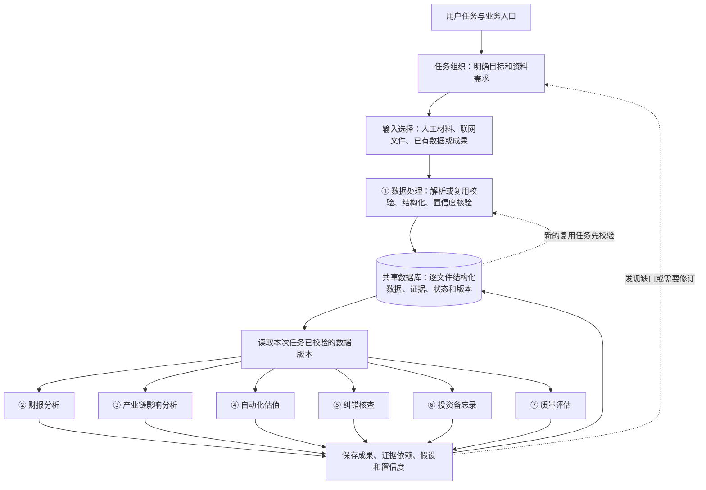

# 金融投研智能体体系构建思路

## 1．体系目标与规划范围

构建覆盖七类金融投研任务的智能体体系，使用户能够分别启动数据处理、财报分析、产业链影响分析、自动化估值、报告纠错、投资备忘录编制和报告质量评估，也能够按任务组合使用这些能力。

体系具备主动发现信息缺口、自主检索资料、优先获取官方原始披露、结构化处理并入库、开展专业分析、交叉核验和生成成果的能力。所有输入、处理结果和分析结论均记录可信依据、核验状态、置信度及适用限制。

本文件统一收录体系架构和七条业务线的完整构建思路，覆盖定位、输入输出、处理流程、业务关系、共享数据及评价要求，可独立阅读和用于后续方案细化。项目目前处于规划阶段，尚未实现模型接入、数据库或业务系统；本文件不指定数据库产品、框架、部署方式和代码接口细节。

## 2．全体系必须遵守的规则

1. **七条业务线均可单独启动。** 每条线具有明确任务入口和独立交付成果，用户无须手动先运行其他业务线。
2. **所有下游业务均先经过第一条。** 第二至第七条的数据输入，由第一条处理或校验，并完成结构化落盘后，再进入相应的专业处理。
3. **任何来源的文件都统一处理入库。** 人工上传、模型自行检索或爬取下载、其他业务线提供的文件，均经过第一条，形成对应的结构化数据档案落盘到数据库。
4. **已有数据校验后复用。** 文件或成果已有适用版本时，第一条检查来源、口径、时点、依赖及核验状态，记录复用关系，无须重复解析。
5. **新增资料先入库再分析。** 研究过程中补充的文件也遵循相同规则，允许分批处理、分析和补充，不要求一次收齐所有资料。
6. **结构化保留原文和信息性质。** 数据关联原始材料及位置，事实、观点、预测和情景假设分别标记。下游可以回看已保存原文，入库不代表所有主张已获证实。
7. **共用数据库服务全部业务线。** 同时保存资料、结构化数据、分析、模型、核查、评价及最终报告，并记录来源和依赖版本。
8. **优先官方证据，尽力补齐重要信息。** 搜索未果不直接以无依据假设填补；记录已查找的来源、剩余缺口及其影响。
9. **全过程核验置信度。** 输入、提取、转换、计算、推理及输出都保留依据；重要结论直接展示置信度、缺口和成立条件。
10. **研究、修订和复用可追溯。** 记录使用的数据、模型、假设、工具及版本；新版本保留与旧版本的关系，支持核心流程复现。

## 3．七条业务线的分类与职责

| 业务类别 | 业务线 | 核心职责 | 主要交付 |
|---|---|---|---|
| 数据处理 | ① 金融文档理解与结构化提取 | 将各类材料转成可核验、可复用的数据，是所有下游业务的前置流程 | 逐文件档案、结构化数据、原文证据、核验状态及版本 |
| 专业研究 | ② 上市公司财务报告分析 | 理解历史经营和财务表现，计算指标并识别异常 | 财务分析、财务与市场估值指标、变化解释及异常清单 |
| 专业研究 | ③ 产业链影响分析 | 理解事件影响的行业和传导路径，匹配企业经营敞口 | 产业关系、影响路径、企业影响及情景测算 |
| 专业研究 | ④ 自动化估值建模 | 自主获取资料、预测经营、选择方法并测算价值 | 预测、估值模型、价值区间及敏感性分析 |
| 核查评价 | ⑤ 研究报告纠错核查 | 核查具体事实、计算、口径、引用和重要论述 | 错误定位、交叉核验、独立复算及修改建议 |
| 综合研究 | ⑥ 买方投资备忘录编制 | 综合分项研究，形成投资逻辑、反证和跟踪条件 | 投资备忘录、风险、失效条件及跟踪清单 |
| 核查评价 | ⑦ 研究报告质量评估 | 基于原始证据和可比研究评价整体质量 | 分项评价、比较结果、核验覆盖及改进建议 |

编号用于业务分类，不规定固定执行顺序。第一条提供共同前置能力；第二至第四条按需求相互补充；第六条形成综合研究；第五、第七条既可服务平台成果，也可独立处理外部报告。

## 4．总体架构与业务关系

### 4.1．统一数据前置架构

图中数据读取以第一条已完成本次处理或复用校验为前提。结果入库后成为其他任务的输入时，再检查其适用性及状态，不能绕过前置流程。第一条本身可以独立完成数据整理和交付。

任务理解、初步方法选择及资料需求规划可以先开展；对新材料的实质分析必须基于已处理并入库的内容。联网搜索摘要可以作为寻找原始资料的线索，纳入分析证据的内容同样需要登记、结构化、核验及落盘。

### 4.2．任务组织与业务执行的分工

| 层次 | 职责 |
|---|---|
| 独立业务入口 | 接受用户对某条业务线的请求，明确对象、时点、范围和预期成果 |
| 共用任务组织 | 查询已有资料，安排数据准备及所需业务，管理依赖、执行进度、补充研究和停止条件 |
| 第一条数据前置 | 处理新文件或校验已有数据，为当前任务提供已入库的明确版本 |
| 各业务线专业执行 | 运用各自方法开展计算、分析、综合或审核，负责本阶段核验及结论 |
| 成果保存与交付 | 保存结果、证据、置信度和依赖，并交付用户或后续业务 |

任务组织是平台共用能力，不增加第八条业务线。第六条负责投资研究内容，可提出财务、产业或估值子任务，但不承担所有其他业务的唯一入口。

七条业务线首先是七种业务能力。是否采用多个模型或独立运行进程，在具体实现阶段依据效果、成本和执行需求确定。

### 4.3．专业成果的主要关系

| 关系 | 传递内容与用途 |
|---|---|
| ① → ②至⑦ | 所有业务所需的结构化材料、数据、原文证据、核验状态及版本 |
| ② → ③ | 企业收入、成本、业务结构及经营基础，用于分析敞口和影响 |
| ② → ④ | 历史财务、指标和异常核验，用于预测起点及估值基础 |
| ③ → ④ | 影响情景及经营变量变化，用于调整预测假设 |
| ②、③、④ → ⑥ | 财务、产业和估值研究，用于形成综合投资判断 |
| ②、③、④、⑥ → ⑤ | 待核查报告及模型、数据和引用，支持错误检查及修订 |
| ⑤ → ⑦ | 具体核查结果、覆盖范围、问题和置信度，构成质量评价依据 |
| 各类报告 → ⑦ | 单份或多份报告，支持整体评价、筛选及改进 |
| ⑤、⑦ → 对应业务线 | 具体问题和改进需求，推动相关内容修订并形成新版本 |

上述箭头表达可复用的业务依赖，传递的数据和成果仍需经过第一条的适用性校验。能够复用成果时不重复运行整条业务，发现缺口时只安排相关补充任务。

第五条核查具体错误，第七条评价整体研究质量。核查通过不证明论证充分，质量高分也不证明全部事实已经核验。各条业务始终负责自身输入和结果的基本核验。

## 5．统一数据、检索与交接规则

### 5.1．每个文件的结构化档案

| 内容 | 需要保存的信息 |
|---|---|
| 文件身份 | 文件标识、名称、来源方式及内容版本 |
| 来源与时间 | 原始出处、来源性质、披露或发布时间、获取时间及适用时点 |
| 原文关联 | 原始材料及可回查的位置，包括章节、页码、表格、单元格等 |
| 结构化内容 | 文本结构、财务或经营字段、事件、实体关系、论点、引用及假设等 |
| 核验与置信度 | 处理状态、核验依据、等级、冲突、缺失及适用限制 |
| 任务与依赖 | 哪个任务使用、关联哪些文件或成果、当前采用的版本 |

每份文件对应一份可追溯档案，档案内可以包含多张表、多个事件及多个论点。跨文件汇总仍保留逐文件证据，一份结构化档案不等于只能生成一行数据。

相同文件经校验可复用，补充或更正保留新版本及差异。无法完整解析时，保存已获得内容及失败或部分完成状态，明确缺失范围；不能伪造完整数据，也不能将未处理内容直接当作已核验依据。

文件已是表格或其他结构化形式时，仍需检查字段、单位、期间、来源及适用性，再入库或复用。业务生成文件在作为后续分析或审核输入时，也遵循该规则。

### 5.2．共享数据库的业务内容

数据库服务全部业务线，规划保存原始材料关联、结构化数据、财务及产业分析、预测和估值模型、核查结果、质量评价、投资备忘录及版本依赖。文件原文的具体保存方式和数据库技术后续确定，结构化结果及其来源关联必须入库。

保留完整追溯关系：**原始资料 → 结构化数据 → 计算与假设 → 分项研究 → 综合结论 → 核查与评价。**

复用前检查公司及对象、业务范围、信息截止时间、统计期间、单位、币种、报表口径、假设、方法和核验状态。已入库、最新版本和高置信度分别是不同属性，不能互相替代。

源数据更正或关键假设变化后，根据依赖识别受影响的指标、分析、估值和报告，按任务重新检查。固定保存每次交付使用的版本，避免数据库更新改变旧报告的依据。

### 5.3．自主检索和官方资料优先

各业务线根据任务判断资料需求，共用联网检索、网页及文件获取、数据接口查询能力。通过可配置的中转API接入模型服务，配置URL、API Key、模型和必要工具；实际联网、来源及内容返回能力需要验证，不能仅以中转URL存在判定可检索。

优先使用公司正式披露、交易所、监管机构、政府部门、央行和统计机构等原始材料；专业数据库、行业协会、研究报告及新闻按适用性补充。重要数字能追溯原始出处时继续核对。官方材料也需区分审计性质、正式事实、管理层预测和更正版本。

研究过程按“明确缺口—查找资料—第一条处理核验并入库—继续分析”循环。达到充分证据、进一步检索无有效增量或任务预算时停止，说明已查找来源、剩余缺口及影响。不得因首轮搜索无结果就编造数据，也不无限调用。

同一来源的转载不计为多份独立证据；外部报告是比较材料，重要内容仍需追溯原始依据。历史任务不得使用当时尚未公开的资料作为已知信息。

### 5.4．统一任务与成果交接

| 方向 | 交接内容 |
|---|---|
| 任务输入 | 目标、业务类型、对象、范围、信息截止时间、数据版本、约束及预期输出 |
| 处理结果 | 结构化数据、计算、分析、核查或评价成果，以及完成状态 |
| 证据与方法 | 原始来源、位置、公式、口径、模型、假设及其性质 |
| 置信度与限制 | 核验状态、等级及理由、冲突、缺口、适用条件和失效条件 |
| 依赖与后续需求 | 数据及成果版本、受到哪些输入影响、需要哪些补充工作 |

直接启动和被其他业务调用使用同一套业务能力与交接规范。跨业务线复用保持事实、推论和假设的性质，不能将上游结论重新包装为独立原始证据。

## 6．七条业务线的构建思路

以下完整展开七条业务线的定位、输入、处理流程、数据结构、输出、评价及衔接要求。各业务线共用本文件规定的数据前置、独立启动、数据库和置信度规则。

### 6.1．第一条业务线：金融文档理解与结构化提取

#### 6.1.1．业务定位

面向各业务线所需的金融研究材料，完成文档理解、信息提取、数据规范化、跨文件关联和证据管理，形成可直接用于后续分析的结构化数据。处理范围覆盖公告、财报、政策、行业资料、市场数据、研究报告和会议纪要等。

本业务线既提供独立的数据结构化服务，也为第二至第七条业务线提供共用的数据处理与证据能力。根据下游任务形成财务数据、经营与市场数据、事件、实体关系、报告观点及假设等不同结构，保留原文和上下文供复核。

第一条是所有分析、综合研究和审核业务的数据前置流程：输入材料先经过数据处理、核验及结构化落盘，再由对应业务线读取明确版本的数据开展专业处理。已有结构化数据或分析成果也经过适用性及核验状态检查，合格后复用已落盘版本，无须重复解析。用户可以直接选择任一业务入口，这一前置流程由系统自动完成。

所有进入业务的文件统一遵循该规则，无论来自人工原始输入，还是业务过程中由模型发现需求后自行检索、爬取或下载。每个文件均建立对应的结构化数据档案并落盘到共享数据库，后续业务读取数据库中的明确版本；不得绕过第一条直接将新文件作为分析依据。

金融事件提取是其中的一项能力，覆盖并购、融资、股权变动、质押、中标、担保、诉讼、监管处罚、政策调整、债券违约等。**材料类型和事件示例均不是封闭清单，系统应支持新类型及下游任务所需的信息结构。**

本业务线负责整理材料中的信息、标记来源性质、检查提取与规范化结果，并明确区分事实披露、作者观点和假设。财务比率计算、业绩解释、产业影响分析、估值、报告纠错及质量评价由对应业务线完成。

全平台采用贯穿七条业务线的置信度核验规则：所有输入数据、处理结果、跨业务线传递的信息及分析结论，都保留置信度评定、核验状态和依据；无法充分核验的内容明确标记。第一条负责基础信息的核验，各业务线负责本阶段处理及分析结论的核验，并在输出中交代结论置信度。

#### 6.1.2．输入设计

| 输入内容 | 初步规划 |
|---|---|
| 文件材料 | 公告、财报及附注、交易文件、监管政策、行业资料、经营与市场数据、新闻、研报、会议纪要等，支持单份或批量输入 |
| 文件格式 | 拟支持文字PDF、扫描PDF、图片、Excel、CSV，具体能力通过测试验证 |
| 任务要求 | 支持自动识别材料并整理相关信息，也支持按用户或下游业务线指定的对象、字段及结构提取 |
| 已有结构化数据 | 支持接入已经整理的数据，检查字段、单位、期间、来源和适用性，符合要求后复用 |
| 可选参数 | 公司、行业、产品及时间范围，分析截止时间，关注对象，字段模板及输出格式 |

默认依据用户提交的材料处理。外部检索作为后续可扩展能力，启用时单独标注来源。

#### 6.1.3．完整业务流程

> 材料与任务接收 → 逐文件登记来源及版本 → 文档解析或已有数据校验 → 信息对象识别 → 按任务确定数据结构 → 信息及证据提取 → 标准化与核验 → 跨文件关联 → 结构化数据、证据及核验状态落盘至共享数据库 → 返回可供下游读取的数据版本。

落盘是进入下游专业处理的前置条件。新材料保存原文及结构化结果，已有合格数据记录本次校验和复用关系；下游通过数据及版本标识读取内容，并可回查已保存的原文上下文。材料中的观点、预测和假设保留各自性质，不因结构化或落盘转成事实。

每个文件档案包含文件标识、来源方式、原文引用、时间与版本、结构化内容、字段证据、处理状态及置信度。一份文件可以包含多张表、多项事件或多个论点，均关联到同一文件档案；跨文件汇总仍保留逐文件来源。相同文件可校验后复用既有结果，更新版本保留关联和差异。

无法完整解析的文件也登记并保存已提取内容及失败或部分完成状态，列明缺失范围；不能伪造完整结构化结果。未处理部分不得直接作为已核验依据使用，补充处理后形成新的可用版本。

业务线可以先根据任务提出资料需求，之后的实质分析基于已处理并落盘的输入。分析中发现缺口时，新增资料再次经过第一条处理、核验和落盘后进入下一轮分析，不要求一次收齐全部信息才开始工作。证据不足的数据保留明确状态，不能用落盘代替核验或将其表述为确定事实。

核心处理要求：

- **按任务识别信息对象**：区分财务科目、经营指标、事件、实体关系、报告主张和假设等；一份材料可同时包含多类对象。
- **识别事件粒度**：一份文件可以包含多个事件，一个事件也可以涉及多份文件，保留已有的事件拆分与关联能力。
- **适应不同材料和任务**：常见类型使用成熟模板，新类型根据内容和下游需求形成专属字段；新增字段保留明确定义。
- **规范数据口径**：统一日期、单位、币种等，同时保留原始表达及必要的统计口径。
- **保留财务与时间语义**：记录公司、报告期、单季或累计期间、合并或母公司口径、披露时间及版本，不混用不同口径和时点的数据。
- **保留材料性质和上下文**：区分正式披露、媒体转述、作者观点和情景假设，保留章节、表格、注释及原文位置，供下游回看。
- **区分事件状态**：明确拟议、批准、实施、完成、终止，以及附带条件。
- **关联事件进展**：识别重复披露、补充公告、更正公告和后续进展，保留版本关系。
- **按需复用和补充**：已有提取结果满足任务时直接复用；缺少字段时针对原始材料补充提取，避免所有业务线重复处理同一材料。
- **处理异常信息**：分别标记未披露、无法识别、存在冲突和计算得到，禁止编造缺失事实。
- **贯穿全流程的置信度核验**：用户输入、联网获取、已有数据接入、提取、转换、关联及跨业务线复用均检查可信依据。每次处理记录输入依赖、核验结果和置信度变化；已核验结果可在版本及适用条件未变化时复用，来源、数据、口径或任务条件变化时重新核验。

大模型负责文档与任务理解、信息对象识别和字段匹配；程序负责单位换算、格式校验及提取过程所需的确定性计算。

#### 6.1.4．数据结构

采用 **“统一来源与对象信息＋按任务组织的专属字段及关系＋字段级证据”** 的结构。

| 数据层 | 内容 |
|---|---|
| 通用来源与对象信息 | 对象编号、对象类型、涉及主体、来源材料及性质、披露或生效时间、版本、处理状态 |
| 财务数据 | 财务科目、数值、单位、币种、报告期、报表范围、原始或重述口径及附注关系 |
| 经营与市场数据 | 产品、产销量、成本、价格、产能、股本、市值等，以及适用时间、地区和统计口径 |
| 金融事件 | 类型、摘要、主体及角色、发生时间、状态、条件及事件专属字段，如收购对价、处罚措施等 |
| 实体与关系 | 公司、产品、行业、上下游及其他材料明确支持的关系；推断关系需单独标记，不能冒充披露事实 |
| 报告内容、观点与假设 | 章节、论点、数字陈述、公式、引用和假设，保留作者归属、原始表述及其对应关系 |
| 字段级证据 | 原始值、规范化值、来源文件、页码或单元格位置、原文片段、处理状态；涉及计算时附公式及输入来源 |
| 置信度与核验信息 | 评定对象、信息性质、置信度等级、核验状态、评定理由、支撑及冲突证据、上游依赖、关键缺口、适用条件、核验时间和版本 |

字段可以动态扩展，但含义、类型和证据表达应保持统一，以便其他业务线直接使用。

##### 6.1.4.1．全平台置信度与核验规则

置信度表示证据对某项数据或结论的支持程度。初步采用高、中、低等级，并设置“待核验／无法判定”状态；评定需有可检查的理由，不能仅采用大模型自报分数。未经样本校准，不将等级或主观评分表述为正确概率，也不编造精确百分比。

| 核验层次 | 主要检查内容 |
|---|---|
| 输入与来源 | 来源真实性、原始披露、时间与版本、适用范围、审计或披露性质、独立证据及冲突 |
| 提取与处理 | 原文对应、OCR或表格识别、单位与期间转换、字段映射、公式、计算及数据关系 |
| 分析与结论 | 数据完整性、方法适用性、推理依据、关键假设、反证、敏感性及上游不确定性的影响 |

等级的初步含义：高表示当前适用范围内证据充分、核验通过且无未解决的重大冲突；中表示存在可说明的缺口或假设，但仍有实质支撑；低表示关键证据薄弱、冲突或对未经验证假设依赖较强。没有足够依据评定时标记待核验或无法判定，不将其视为事实错误。

官方来源不自动等于全部内容高置信度；提取正确不自动等于原文主张成立；计算正确不自动等于预测可靠。用户提供的信息和假设同样记录来源及依据，用户设定仅代表情景条件，不证明其未来会实现。

下游结论必须评估关键输入的不确定性，不能仅因重新生成文字或计算而提高置信度。关键低置信度输入对结果的影响应通过敏感性或情景分析交代；不机械平均、相乘或取所有输入的最低值。多家转载同一来源不计为多份独立证据，新证据提高置信度时记录理由。

重大冲突、关键缺失或无法核验的内容优先补充检索、复算或提交复核；仍不能解决时，保留标记并限制结论范围。可以给出明确的条件性结果，但不能输出无依据的确定判断。估值或情景结果的范围不自动构成统计置信区间，情景条件下计算可靠性与情景实现可能性分别说明。

各项数据及处理结果在结构化记录中保留置信度信息；报告和界面逐项展示重要结论的置信度、理由、关键依赖、缺口和失效条件，其他数据可下钻核验。整体摘要不能掩盖局部低置信度结论。

#### 6.1.5．输出成果

1. **材料与数据总览**：展示处理材料、识别出的信息对象、数据覆盖范围及处理状态；事件任务保留事件总览表。
2. **已入库的逐文件档案及分类结构化数据**：每个文件形成对应的结构化档案，按任务交付财务数据、经营与市场数据、事件详情、实体关系、报告主张等，保存至共享数据库并提供文件、数据与版本标识，支持表格和JSON导出及下游业务复用。
3. **证据、置信度与异常清单**：逐字段查看依据、置信度等级及理由，定位缺失、冲突及待复核内容，说明处理结果的适用限制。
4. **执行记录**：保存文件访问、模型与工具调用、处理步骤、模板版本和结果生成情况，支持追溯与复现。

人工修订需要保留修改记录，并与系统原始输出区分。

#### 6.1.6．评价标准

以下为项目拟采用的评价体系，具体权重和达标阈值尚未确定。

| 评价维度 | 重点检查 |
|---|---|
| 准确性与完整性 | 各类信息对象和字段是否提取正确，是否遗漏或凭空增加信息 |
| 口径与状态准确性 | 单位、币种、期间、报表范围、比例分母、事件阶段及附带条件是否正确 |
| 证据可靠性 | 来源定位是否准确，证据是否真正支持对应字段 |
| 置信度评定质量 | 输入及处理结果是否完整记录核验依据，等级是否与人工核验表现一致，是否出现高置信度错误或不确定性在传递中丢失 |
| 结构合理性 | 字段是否覆盖关键事实，类型与格式是否规范 |
| 通用性 | 不同材料、信息对象、文档格式及未配置模板的新类型能否处理 |
| 关联与版本处理能力 | 是否正确处理实体对应、多事件、跨文件信息、重复披露、更正和后续进展 |
| 下游可用性 | 输出能否满足财报分析、产业分析、估值、研报核查等任务的数据要求，且保留原文回查能力 |
| 信息性质区分 | 是否将材料中的观点、推测、假设或媒体转述错误标记为确定事实 |
| 异常处理能力 | 能否识别缺失、不可读和冲突信息 |
| 稳定性与效率 | 重复运行的一致性、处理耗时、成本和失败比例 |

评测采用人工标注样本，标注**信息对象、字段值、对象关系及证据位置**。开发集与测试集分开，保留未配置专用模板的材料或事件类型，并按材料类型、信息对象和下游任务分别报告结果。下游任务验证聚焦输入数据的适用性，分析结论质量由对应业务线另行评价。

置信度评测按等级检查实际错误、未核验覆盖及高置信度错误，不能通过把所有内容标低或拒绝输出来掩盖能力不足。未来若采用概率数值，需定义可检验的目标并用独立样本校准；当前不预设未经验证的概率和评分权重。

#### 6.1.7．业务衔接与当前规划边界

整体采用**统一数据前置流程、先核验并结构化落盘、再按业务能力分析、成果版本化保存**的方式。第二至第七条均经过第一条的数据准备流程；用户无须手动执行前置步骤，已有数据可在校验后复用。各业务线负责自身专业计算和判断，并将结果、证据依赖、假设及置信度按统一规范保存，供后续业务再次校验和复用。

| 下游业务线 | 第一条提供的主要输入 |
|---|---|
| 第二条：上市公司财务报告分析 | 报表数据、附注、经营信息和相关事件及证据 |
| 第三条：产业链影响分析 | 事件、政策内容、产业关系材料、企业经营及供需数据 |
| 第四条：自动化估值 | 财务、经营、市场和可比公司数据，以及材料或用户提供的假设 |
| 第五条：研究报告纠错核查 | 待核查报告中的数字、公式、主张、引用及对应原始材料 |
| 第六条：买方投资备忘录编制 | 公司、行业、市场及事件资料，供其结合其他业务线成果开展综合研究 |
| 第七条：研究报告质量评估 | 报告结构、论点、引用、假设及原文上下文，供其开展质量评价 |

当前规划明确：**通用金融材料定位、所有下游业务的数据前置流程、先结构化核验并落盘再开展分析、多类数据对象、字段级证据、原文保留、版本化复用及贯穿七条业务线的置信度核验与披露。**

后续需要细化：首批样本集、各类数据对象和字段定义、动态结构生成规则、跨文件关联与版本规则，以及下游输入规范和评价指标计算方法。本文保持初步业务规划粒度。

### 6.2．第二条业务线：上市公司财务报告分析

#### 6.2.1．业务定位

面向上市公司年度报告、半年度报告、季度报告及相关材料，自动提取财务信息、对齐统计口径、计算财务与估值指标、解释业绩变化、识别异常信号，形成可核验的财务分析成果，为其他业务线提供数据和分析依据。

核心目标是回答：**公司经营发生了什么变化、变化可能由什么驱动、盈利和现金流质量如何、有哪些需要关注和进一步验证的事项。**

系统应具备跨公司、跨报告期的分析能力，并根据行业特征调整分析重点。本业务线主要分析已披露的经营和财务表现；在具备市场数据时计算给定日期下的估值指标。未来盈利预测、合理价值测算及投资判断由后续业务线开展。

#### 6.2.2．输入设计

| 输入内容 | 初步规划 |
|---|---|
| 核心材料 | 年报、半年报、季报，包括财务报表、附注及经营讨论 |
| 补充材料 | 业绩预告、业绩快报、更正公告、审计报告、问询回复、业绩说明会等 |
| 分析任务 | 支持全面分析，也支持利润变化、现金流质量、偿债能力等专项分析 |
| 分析范围 | 公司、报告期、比较期间、分析截止时间、关注指标 |
| 可选比较材料 | 同行业公司财报、行业经营数据等 |
| 可选市场数据 | 指定日期的股价、股本、市值及其他估值指标所需数据，保留日期、来源及口径 |

支持单份和多份材料输入：

- **单份报告**：利用其中实际披露的当期和比较数据分析，明确缺少的历史信息。
- **多期报告**：分析趋势、季度变化及异常的持续性。
- **多家公司报告**：在口径和业务具有可比性的条件下开展横向比较。

仅提供财报时生成适用的财务指标；具备市场数据后，再生成P/E等市场估值指标。材料不足时，应明确缺失信息及无法完成的分析，不能编造数据。

#### 6.2.3．完整业务流程

> 接收财报分析任务 → 第一条完成材料处理或已有数据校验 → 结构化数据、证据及核验状态落盘 → 读取明确数据版本 → 财务口径复核与指标计算 → 业绩变化与原因分析 → 异常识别与复核 → 成果生成、保存与交付。

数据准备是本业务的必经前置阶段。用户原始财报、市场资料及上游成果均先由第一条处理或校验，专业分析读取已落盘版本；新增资料也按相同流程进入分析。已有合格结果可复用，第二条继续负责财务专业核验、计算及结论置信度。

| 步骤 | 主要处理内容 |
|---|---|
| 材料接收与识别 | 确认公司、报告类型、报告期、披露时间和版本，明确材料覆盖范围 |
| 财务信息提取 | 提取报表、附注、分部信息和经营讨论，并保留原文依据 |
| 口径对齐与核验 | 对齐期间、单位、币种、报表范围，检查数据关系、重述和版本冲突 |
| 指标计算 | 计算适用的同比、环比、财务比率及市场估值指标，保留公式和输入数据 |
| 变化与原因分析 | 识别重大变化，结合附注、经营讨论和相关事件分析可能的驱动因素 |
| 异常识别与复核 | 检查利润与现金流背离等信号，结合行业、季节性和经营背景复核 |
| 成果生成与交付 | 汇总分析结论、指标、证据、异常及分析局限，形成可追溯的输出 |

核心处理要求：

- **期间一致**：区分年度、累计期间和单季度数据；推导单季度数据时使用可比材料，并保留推导过程。
- **存量与流量区分**：资产负债表期末余额与利润表、现金流量表期间发生额采用各自适用的分析方法。
- **报表口径一致**：区分合并报表与母公司报表、本期重述比较数与此前披露数，不能静默混用。
- **特殊基数处理**：上期为零、负数或很小时，说明增长率的适用性，并结合绝对变化、扭亏或转亏情况解释。
- **信息时点约束**：按分析截止时间使用已披露材料；历史估值不得使用当时尚未公布的财务数据。
- **证据与推论区分**：明确区分披露事实、计算结果、管理层解释和系统推论，说明推论依据及待验证条件。
- **异常不等于违规**：财务异常仅作为进一步研究的信号，不能据此直接认定财务造假或经营失真。
- **全过程置信度核验**：遵循本文件第6.1节中的全平台规则，核验用户输入、市场数据、上游结果及每阶段处理结果的可信依据；指标计算和分析结论分别评定置信度，保留依赖关系。重要输入发生变化时重新核验，不能因公式计算正确就认定业绩解释可靠。

大模型负责材料理解、证据检索和分析组织；程序负责确定性计算、口径检查及规则核验。

#### 6.2.4．分析模块与指标体系

采用 **“通用财务分析＋行业适配＋用户专项问题”** 的结构，建立可计算、可比较、可解释、可追溯的财务与估值指标体系。

| 分析类别 | 典型指标或内容 | 主要作用 |
|---|---|---|
| 经营与成长 | 营收增长率、归母净利润增长率、扣非归母净利润增长率、分业务表现 | 判断经营增长及变化来源 |
| 盈利能力 | 毛利率、净利率、费用率、ROE、ROA、ROIC | 判断盈利水平及资本使用效率 |
| 营运效率 | 应收账款周转率、存货周转率、总资产周转率及周转天数 | 判断资产和营运资金使用效率 |
| 偿债与流动性 | 资产负债率、流动比率、速动比率、利息保障倍数、债务期限结构 | 判断债务负担和偿付能力 |
| 现金流与盈利质量 | 经营现金流／净利润、经营现金流／营业收入、自由现金流、非经常性损益及减值影响 | 判断利润的现金支撑、持续性和资金状况 |
| 市场估值 | P/E、P/B、P/S、EV/EBITDA、股息率 | 衡量市场价格与盈利、净资产、收入等的关系 |
| 会计与披露事项 | 会计政策或估计变更、合并范围变化、报表更正、审计意见、重要附注 | 判断可比性及披露中的重要关注事项 |

上述指标是示例，不构成封闭清单。自由现金流等金额指标也纳入体系。具体指标按行业、用户任务及数据可得性选择，不能要求所有公司计算全部指标，也不能对银行、保险、制造业等套用同一套业务解释。

##### 6.2.4.1．市场估值指标的口径

以常见总市值口径为例：

> P/E（TTM）＝估值日总市值 ÷ 最近十二个月归母净利润。

总市值、财务数据和公司股权口径需要匹配；采用每股口径时，也应保证股价与每股收益口径一致。

| 指标 | 利润口径 |
|---|---|
| 静态P/E | 最近完整年度的利润 |
| P/E（TTM） | 最近十二个月的利润 |
| 预测P/E | 明确预测年度或预测期间的利润，须有对应预测数据及来源 |

不能将季度利润直接乘以4作为TTM利润。遇到亏损、分母为零、数据不足等情况，应标明不适用或具体限制，不能仅凭低倍数或负倍数判断低估。

预测P/E作为指标口径予以区分；本业务线不承担未来利润预测。若使用外部或第四条业务线提供的预测数据，须明确预测来源、期间、版本和假设。

##### 6.2.4.2．业绩解释与异常识别

分析需要覆盖收入、成本、费用、减值、非经常性损益、资产和营运资金变化等可能因素。材料充分时可量化拆分贡献，材料不足时只给出有依据的解释和待验证事项。

例如，收入增长、应收账款增长更快且经营现金流下降，可以提示回款和营运资金占用值得关注，但仍需结合信用政策、账龄结构及季节性判断。

#### 6.2.5．数据结构与输出成果

##### 6.2.5.1．财务与估值指标表

| 字段 | 内容 |
|---|---|
| 公司与指标名称 | 标识所属公司及具体指标，如P/E（TTM）、ROE |
| 所属期间或估值日期 | 明确指标对应的财务期间及适用的市场日期 |
| 指标值及单位 | 数值及倍、百分比、天数、金额等单位 |
| 公式与计算口径 | 分子、分母、期间、报表范围、平均值或期末值等定义 |
| 输入数据及来源 | 原始数据、文件、页码、表格或原文位置；市场数据附日期及来源 |
| 比较结果 | 上期、去年同期；条件允许时加入可比公司比较 |
| 状态与解释 | 正常、缺失、不适用、口径变化、变化说明及必要限制 |
| 置信度与核验依据 | 输入数据、处理和指标结果的置信度等级、核验状态、证据、冲突、关键缺口及上游依赖 |

公司直接披露的指标与系统自行计算的指标分别标识。例如，自行计算的ROE不能未经说明等同于公司披露的加权平均ROE。

##### 6.2.5.2．输出成果

1. **财务分析报告**：经营表现、业绩变化及原因、盈利和现金流质量、主要关注事项；逐项说明重要结论的置信度、理由、依赖假设、待核实事项及适用条件。
2. **标准化财务数据与指标表**：原始数据、财务比率、适用的估值指标、比较结果、公式及口径，支持表格和JSON导出。
3. **重大变化与异常清单**：变化内容、触发依据、证据、可能解释和待验证事项；分别交代数值变化是否成立、异常识别依据及原因解释的置信度。
4. **证据索引**：将关键数字和结论关联到原始材料，支持逐项核查。
5. **执行与限制说明**：使用材料、分析截止时间、缺失信息、无法完成的分析及运行记录。

人工修订保留修改记录，并与系统原始输出区分。

#### 6.2.6．评价标准

以下为项目拟采用的评价体系，具体权重和达标阈值尚未确定，不代表官方已公布的评分细则。

| 评价维度 | 重点检查 |
|---|---|
| 数据准确性与完整性 | 财务数据是否提取正确，是否遗漏任务所需的重要信息 |
| 口径与时点正确性 | 是否正确处理期间、单位、报表范围、重述、非经常性损益及数据披露时点 |
| 计算准确性 | 同比、环比、财务比率、估值指标及推导过程是否正确、可复算 |
| 变化解释质量 | 是否识别重要驱动因素，解释是否有证据，是否把相关性误当成因果 |
| 异常识别能力 | 是否发现有依据的异常信号，同时控制漏报和误报 |
| 专业适用性 | 是否考虑行业差异、季节性、企业经营特点及指标适用范围 |
| 证据与表达质量 | 是否区分事实、计算、管理层解释和系统推论，引用是否支持结论 |
| 置信度评定与传递 | 数据、指标和结论是否说明核验依据，关键输入的不确定性是否传递，等级是否与复核结果相符，是否出现高置信度错误 |
| 稳定性与效率 | 关键数据和结果是否一致，处理时间、成本和失败比例是否合理 |

评测分为两个层次：

- **客观层**：用人工核验的数据、公式、口径和来源检查提取与计算。
- **分析层**：由具备财务知识的人员依据明确标准，评价解释、异常判断和证据充分性，允许多种合理表述。

开发材料与测试材料分开。测试样本覆盖不同报告期、行业、盈亏状态，以及会计变更、重述、合并范围变化、市场数据缺失等情况。

#### 6.2.7．业务衔接与当前规划边界

第二条可作为独立用户入口接受原始财报，系统先执行第一条“金融文档理解与结构化提取”的数据准备与落盘，再进入财务分析。已有结构化数据经第一条校验后复用已保存版本，需要新增字段时先补充提取、核验及落盘。

- **与第一条衔接**：第一条提供财务报表、附注、经营信息的结构化结果及原文证据，并保留期间、单位、报表范围和版本等口径；识别出的并购、处罚、融资、诉讼等事件提供补充证据。第二条负责分析所需的专业口径核验、财务与估值指标计算、变化解释及异常识别。
- **与第四条衔接**：第二条计算历史财务比率及给定日期下的估值倍数；第四条进行经营预测、估值假设设定、合理价值测算和敏感性分析。
- **与第五、第六条衔接**：标准化财务数据、计算结果和关注事项，可供研报核查及投资备忘录编制使用。

当前规划明确：**支持全面及专项财报分析，建立财务与估值指标体系，依据行业和数据条件选择指标，保留完整计算依据及证据，并输出业绩解释、异常信号和分析局限。**

后续需要细化：行业适配范围、指标定义与口径、材料及市场数据规范、异常识别规则、测试样本及评价指标计算方法。本文保持初步业务规划粒度，不展开具体构建实现。

### 6.3．第三条业务线：产业链影响分析

#### 6.3.1．业务定位

面向用户提供的事件、文件或假设情景，自动识别可能受影响的行业，主动检索产业资料，构建并核验相关产业关系，分析影响沿产业链传导的机制，以及对企业经营和盈利的作用。

核心目标是回答：**什么发生了变化、哪些行业及企业可能受影响、影响如何传导、影响程度如何、结论在什么条件下成立。**

系统支持价格、供给、需求、政策、技术和重大事件等不同类型的变化。分析范围可以涉及多个行业，并考虑上游向下游、终端需求向上游的传导，以及替代、互补和反馈关系。上述类型不是封闭清单。

本业务线负责产业关系研究、影响路径分析、企业经营敞口识别及条件性影响测算。合理价值测算和综合投资判断由后续业务线完成，企业经营受益或承压不能直接等同于股票上涨或下跌。

#### 6.3.2．输入设计

| 输入内容 | 初步规划 |
|---|---|
| 研究起点 | 一项实际事件、一份或多份文件、一组假设情景，或者一个明确的研究问题 |
| 已有结构化结果 | 第一条业务线输出的事件、政策内容、实体关系、经营数据及证据等，校验适用性后直接复用 |
| 事件材料 | 公告、政策原文、新闻、行业报告、价格或供需数据等 |
| 产业关系材料 | 产品用途、生产流程、上下游关系、客户供应商信息及相关行业研究 |
| 企业经营材料 | 财报、分部收入、成本构成、产销量、产能、采购销售安排等；可使用第二条业务线的分析成果 |
| 分析范围 | 可指定行业、产品、企业、地区、分析截止时间及影响期间；未指定行业时由系统初筛并核验 |
| 可选情景参数 | 价格变化幅度、需求增速、停产时间、成本转嫁比例等，保留参数来源及假设性质 |

支持两种研究模式：

- **实际事件分析**：研究已经发生或正式披露的变化，区分事件状态、发生时间和披露时间。
- **假设情景分析**：研究用户给定条件下的可能影响，明确标记情景假设，不将其表述为已发生的事实。

用户不必预先提供完整的行业清单和产业链资料。系统根据任务主动补充检索，并说明最终覆盖范围、资料缺口及无法完成的分析。

#### 6.3.3．完整业务流程

> 接收事件或文件 → 第一条处理或校验输入并结构化落盘 → 读取数据版本并识别冲击因素 → 初筛可能受影响的行业 → 联网检索产业资料 → 第一条处理新增材料、核验并落盘 → 构建并核验产业关系 → 修正行业范围 → 分析传导路径和企业敞口 → 情景测算 → 复核、保存与交付。

本业务以第一条的数据准备与落盘为前置条件。事件、政策、产业资料和其他业务线成果均先处理或校验，再以已保存的版本进入分析；研究过程中每轮新增资料重复执行该前置流程，原文上下文可通过保存的证据回查。

| 步骤 | 主要处理内容 |
|---|---|
| 事件与情景识别 | 明确变化对象、方向、幅度、地区、时间、事件状态及附带条件 |
| 影响机制初判 | 判断可能涉及供应数量、需求、价格、成本、运输、技术替代或其他作用渠道 |
| 候选行业初筛 | 根据产品用途和可能的传导关系，提出待验证的行业及产业环节 |
| 主动检索与材料整理 | 根据研究问题查找资料，调用第一条提取相关信息、数据、关系及证据 |
| 产业关系构建与核验 | 核验上下游、替代、互补及供需关系，补充遗漏并删除依据不足的关联 |
| 传导路径分析 | 逐步说明价格、销量、成本、产能利用率、交付周期或资金占用如何变化 |
| 企业敞口识别 | 结合企业实际业务、占比、供应来源、客户结构、合同及库存等判断受影响程度 |
| 影响测算 | 在数据充分时测算经营及财务影响，保留假设、参数、公式及情景差异 |
| 反向检查与交付 | 检查缓冲因素、相反作用、重复计算和信息缺口，输出结论及适用边界 |

研究过程允许按需循环：**提出问题 → 检索材料 → 结构化处理 → 分析证据 → 发现缺口 → 补充检索。** 初筛行业属于候选范围，重要产业关系和结论需要证据核验，不能仅凭模型已有知识确定。

系统按事件需要构建相关产业关系，无须每次重建整个行业的全部产业链。设置检索预算和停止条件；材料不足或达到研究边界时，交付已完成的分析并标明未解决问题。

遵循本文件第6.1节中的全平台置信度规则，对事件输入、检索资料、结构化结果、产业关系、传导路径、企业敞口及测算结果逐阶段核验并记录置信度及依据。沿依赖关系检查不确定性，不能将候选行业、推测关系或模型自报分数当作已核验事实。

#### 6.3.4．分析内容与联网能力

##### 6.3.4.1．产业关系与传导机制

分析至少关注以下问题：

- 原料、产品、政策或事件具体作用于哪些产业环节，适用范围和例外条件是什么。
- 下游如何使用相关投入，是否存在替代材料、供应商、技术或产品。
- 企业对特定地区、供应商、客户或产品的依赖程度如何。
- 库存、采购合同、定价安排、产能限制和套期保值等如何缓冲或放大影响。
- 影响经过多久传导，价格变化能否向下游转嫁。
- 是否存在相反路径、反馈作用及多事件叠加，是否可能重复计算同一影响。

每条重要路径应说明影响来源、影响对象、作用机制、方向、时滞、成立条件及证据。产业关系存在，不代表影响必然显著；缺少证据的关系保留为待核实事项。

分别说明关系存在、影响方向和影响幅度的置信度。某条产业关系证据充分，不代表企业盈利影响幅度同样可靠；关键环节的冲突或缺口需在相关结论中体现，不能由其他高可信材料掩盖。

##### 6.3.4.2．影响测算层次

| 层次 | 可输出的分析 |
|---|---|
| 方向判断 | 可能受益、承压、影响有限或方向不确定，并说明依据和条件 |
| 经营影响测算 | 对采购成本、产品售价、销量、产能利用率等变量的情景影响 |
| 财务影响测算 | 在经营测算基础上，进一步分析收入、毛利、现金流及具备充分依据的盈利变化 |

例如，原材料价格上涨10%，不能直接推出企业总成本上涨10%或净利润下降10%。需要考虑实际耗用量或成本占比、采购价格变化、库存及合同、成本转嫁能力、销量变化和其他缓冲因素。

参数不确定时设置具有依据的情景，输出影响区间和敏感性分析。情景结果不是确定预测；材料不足时保留方向判断和待验证事项，不强行生成精确利润数字。

##### 6.3.4.3．通过中转API接入联网模型服务

模型服务通过可配置的中转API接入，以具备实际联网检索能力的服务作为设计前提。中转URL是调用入口，实际搜索能力取决于模型服务及中转接口开放的工具，接入后需验证。

| 能力 | 要求 |
|---|---|
| 可配置接入 | 配置中转URL、API Key、模型名称及必要的工具设置；密钥不写入报告或执行日志 |
| 实际联网检索 | 能围绕任务查找外部资料，不能仅以模型已有知识代替检索 |
| 来源与内容返回 | 返回可核验的来源链接和实际使用的内容，能够保留发布时间、获取时间及引用依据 |
| 过程记录 | 保存可获取的检索调用、返回材料及分析使用情况，明确服务侧未返回的过程信息 |
| 范围控制 | 根据部署环境配置允许访问的来源、接口和分析截止时间 |

第三条负责判断研究方向和信息缺口，联网能力负责获取材料，第一条负责结构化处理及证据管理。新增材料仍进入统一数据流程，不直接把无来源的模型回答作为产业事实。

优先使用政策原文、公司公告、交易所及行业权威资料；对媒体报道和研究观点标明来源性质。历史事件分析只使用截至指定时间已经公开的信息，避免后见信息进入当时的判断。

#### 6.3.5．数据结构与输出成果

采用 **“事件或情景＋产业关系＋传导路径＋企业敞口＋测算结果＋证据及限制”** 的结构。

| 数据层 | 内容 |
|---|---|
| 事件或情景 | 变化对象、方向、幅度、时间、地区、状态、条件及事实或假设标记 |
| 行业与产业关系 | 行业、产品、环节、实体及上下游、替代、互补等关系，记录来源和核验状态 |
| 传导路径 | 影响来源与对象、作用机制、方向、时滞、成立条件、缓冲因素及证据 |
| 企业经营敞口 | 企业实际业务、相关收入或成本占比、采购销售安排、地区和其他适用口径 |
| 测算与情景 | 基准、变量、假设、参数来源、公式、输入数据、结果区间及敏感性 |
| 证据与限制 | 原始材料位置、来源性质、发布时间、获取时间、分析截止时间、信息缺口和待验证事项 |
| 置信度与核验信息 | 数据、关系、处理结果和结论的等级、核验状态、评定理由、上游依赖、冲突及关键假设，区分情景计算可靠性与情景实现可能性 |

最终输出：

1. **产业链影响分析报告**：事件背景、研究范围、主要传导路径、受影响环节和企业、结论及适用边界；逐项展示重要结论的置信度、理由、关键证据、缺口及失效条件。
2. **传导关系图及明细表**：展示影响如何逐步传递，并关联机制、条件和证据。
3. **企业影响清单**：企业相关业务、受影响机制、经营敞口、判断依据及不确定性。
4. **情景测算与敏感性分析表**：参数、公式、结果、影响区间、主要敏感因素及其置信度依据；数据不足时说明不能量化的原因，未经统计建模与验证不将情景区间称为置信区间。
5. **风险与跟踪清单**：结论可能失效的条件、待核实事项及后续需要观察的指标。
6. **证据材料包与执行记录**：记录检索、材料处理、计算和结果生成情况，支持检查及基于固定材料重新运行核心分析流程。

结构化结果支持表格及JSON导出，供其他业务线复用。人工修订保留修改记录，并与系统原始输出区分。

按来源许可保留足以复核的原文、数据或快照，保存实际使用的材料版本；记录模型版本、提示配置、工具及运行参数。复现不能仅依赖重新搜索可能已经变化的网页，模型生成结果的一致性仍需单独验证。

#### 6.3.6．评价标准

以下为项目拟采用的评价体系，具体权重和达标阈值尚未确定，不代表官方已公布的评分细则。

| 评价维度 | 重点检查 |
|---|---|
| 事件理解准确性 | 是否正确理解变化对象、时间、幅度、状态、政策范围和附带条件 |
| 行业识别与研究覆盖 | 是否识别重要行业及环节，同时避免无依据扩散，是否明确覆盖范围和遗漏风险 |
| 检索与来源质量 | 检索是否解决关键问题，来源是否可核验、与任务相关且满足信息时点要求 |
| 产业关系准确性 | 上下游及其他关系是否真实，是否匹配企业实际业务 |
| 传导逻辑严密性 | 每一步是否有合理机制，是否考虑关键条件、缓冲因素、相反作用及时间滞后 |
| 企业敞口判断 | 是否考虑业务占比、合同、库存、产能及依赖程度，避免仅凭行业标签判断影响 |
| 量化合理性 | 公式、单位、参数及数据是否合理，是否存在重复计算或虚假精确结果 |
| 证据与不确定性表达 | 是否区分事实、推论和假设，证据是否支持结论，是否明确适用边界与失效条件 |
| 置信度评定与传递 | 是否逐阶段核验并保留依据，是否区分关系、方向、幅度和情景假设的可信程度，等级是否与复核结果相符，是否存在高置信度错误 |
| 稳定性、可复现性与效率 | 固定材料下关键事实和计算是否一致，材料和过程能否复核，时间、成本及失败比例是否合理 |

评测结合人工核验的事件与产业关系、可复算的测算案例及专业人员评价。开发材料与测试材料分开，覆盖不同事件、行业、材料充分程度，以及弱关联、无显著影响和相反作用的案例。

历史复盘限定当时可获得的信息；后续实际结果可以用于检验，但不能将企业全部业绩变化归因于单一事件。产业机制和条件性判断允许多种合理分析路径，按证据、逻辑及计算质量评价。

#### 6.3.7．业务衔接与当前规划边界

第三条可直接接受用户材料或其他业务线结果，由系统先执行第一条的数据处理或校验及落盘，再开展产业分析。用户无须手动运行第一条，第二条仍按财务分析需要调用。

- **与第一条衔接**：接收其结构化事件、政策、经营数据及证据；联网获取的新材料再次交由第一条整理，复用已有结果并按需补充提取。
- **与第二条衔接**：使用企业收入结构、成本构成、财务指标及经营分析，作为敞口识别和影响测算的基础。
- **与第四条衔接**：提供有依据的影响情景、经营变量变化和条件，由第四条纳入盈利预测及估值假设。
- **与第六条衔接**：提供产业变化、企业影响、风险和跟踪指标，用于投资备忘录编制。

当前规划明确：**自主初筛受影响行业、通过中转API接入联网检索、按任务理解并核验产业关系、复用第一条结构化能力、分析传导机制及企业敞口、按证据条件量化影响并保留完整来源。**

后续需要细化：模型及中转服务的能力验证、行业识别和检索停止规则、产业关系及企业敞口字段、情景测算口径、样本集和评价指标计算方法。本文保持初步业务规划粒度，不展开具体构建实现。

竞赛部署须满足受控数据环境、过程记录和可复现要求。实时搜索、外部模型API及现场网络的具体限制，以后续赛事细则为准；当前公告未明确授权无限制联网。

参考：[2026年北京市大学生金融人工智能竞赛官方通知](https://jw.beijing.gov.cn/gjc/tzgg_15688/202608/t20260827_4839055.html)。

### 6.4．第四条业务线：自动化估值建模

#### 6.4.1．业务定位

面向指定公司开展自主估值研究，从少量任务信息出发，主动获取并核验相关数据，理解业务与财务基础，选择适用的估值模型，形成经营预测和估值假设，输出可复算、可追溯的估值区间及其置信度说明。

核心目标是回答：**在给定信息时点和经营假设下，公司的合理价值区间是多少、依据是什么、哪些因素会显著改变结果，以及结论具有怎样的可信程度。**

本业务线支持独立启用。用户可以只提供公司名称或证券代码、估值日期和任务要求，由系统确认对象、列出数据需求并自主获取资料；也可使用用户上传材料及前几条业务线的成果。用户无须事先收集全部数据或手动执行其他业务线。

估值模型及其依据是核心成果。第二条负责历史财务分析及给定日期下的估值指标计算，第四条进一步进行经营预测、目标估值参数选择、合理价值测算及情景分析。估值结果与市场价格的差异不代表价格一定会收敛。

#### 6.4.2．输入设计

| 输入内容 | 初步规划 |
|---|---|
| 基本任务信息 | 公司名称或证券代码、上市市场、估值日期、估值任务；公司身份有歧义时先消除歧义 |
| 用户材料 | 财报、附注、公告、经营资料、行业研究、可比公司资料等，可提供但不要求完整 |
| 上游结构化结果 | 第一条整理的财务、经营、市场及事件数据，第二条的历史分析，第三条的产业影响情景 |
| 估值偏好 | 可指定估值方法或要求系统推荐，明确估值对象和价值口径 |
| 用户假设 | 增长、利润率、资本开支、折现率、目标倍数等，可提供也可由系统提出并说明依据 |
| 分析约束 | 信息截止时间、预测期间、币种、研究范围、允许使用的数据来源及研究预算 |

所有输入均进行来源、口径、时点和置信度核验，包括用户材料、已有结构化结果和用户假设。明确区分已披露事实、管理层指引或第三方预测、模型假设及尚未获得的信息。用户设定只代表情景条件，不证明该条件未来会实现。

历史估值只能使用估值时点已经公开的数据及预测版本，不能将后来发布的报告、更正或实际结果作为当时已知信息。最新估值同样需要明确各项数据的日期和适用期间。

#### 6.4.3．完整业务流程与自主数据获取

> 确认公司及估值边界 → 初选估值方法并建立信息需求 → 获取资料或查询已有成果 → 第一条处理或校验数据、核验置信度并结构化落盘 → 读取明确版本并检查缺口 → 补充研究及数据准备 → 形成经营预测与假设 → 执行估值计算 → 情景及敏感性分析 → 模型复核与结论置信度评定 → 成果保存与交付。

资料需求规划可先开展；用于历史分析、经营预测和估值计算的数据，必须先经过第一条处理或校验并落盘。用户材料、市场数据和其他业务线成果均遵循该要求，新增材料在补充处理及保存后再进入模型。已有合格数据可复用已保存版本，不重复解析。

| 步骤 | 主要处理内容 |
|---|---|
| 确认估值边界 | 确认公司、业务范围、日期、币种及信息截止时间，区分企业价值、股权价值和每股价值 |
| 初选方法及需求清单 | 根据业务和行业特点初选模型，列出必需数据、可选数据、口径及用途 |
| 主动获取资料 | 通过联网检索、数据接口查询、网页及文件获取，优先收集官方原始披露 |
| 结构化与基础核验 | 调用第一条整理材料、数据、来源及版本，检查提取、单位、期间和适用口径 |
| 缺口检查与补充研究 | 逐项确认已获得什么、是否可靠、还缺什么及下一步来源，必要时修正方法选择 |
| 历史分析与预测 | 按需调用第二条核验历史基础，结合业务驱动因素和第三条情景形成预测 |
| 估值建模与计算 | 形成现金流折现或相对估值模型，保留输入、公式、中间结果及价值口径转换 |
| 情景和敏感性分析 | 检查经营及估值参数变化的影响，说明重要假设和薄弱证据对结果的作用 |
| 复核与交付 | 检查财务关系、计算、重复计入、模型适用性及证据，交付结果、置信度和未解决问题 |

##### 6.4.3.1．资料获取优先级

以高可信度官方原始披露为优先证据，尽可能补齐估值所需信息；不能在首次搜索无结果后直接用无依据的假设替代。

| 来源优先级 | 主要来源及用途 |
|---|---|
| 第一优先 | 交易所、监管机构、公司正式披露平台和投资者关系网站，获取财报、附注、公告、股本、融资、并购及投资计划等 |
| 第二优先 | 政府部门、央行、统计机构、官方市场发布渠道，获取利率、政策、宏观、行业统计及市场数据 |
| 补充来源 | 行业协会、专业数据库、可核验的研究报告和新闻，补充行业、可比公司数据及研究线索 |

对补充来源中的重要数字，能追溯原始披露时继续核对原始材料。多家转载同一来源不构成多份独立证据。官方财报、未经审计的快报及管理层预测分别标识，不能仅因来源官方就统一认定为高置信度。

收集范围根据模型需求覆盖报表及附注、分部经营、受限资金、债务、资本开支、租赁、少数股东权益、股本等，不仅停留于收入和净利润摘要。历史材料通常可先收集最近3—5年及最新一期；这不是硬性下限或上限，周期企业等按研究需要扩展。

##### 6.4.3.2．联网接入与缺口处理

通过可配置的中转API接入具备实际联网检索能力的模型服务，配置中转URL、API Key、模型名称及必要工具设置。实际搜索和资料获取能力需在接入时验证，返回可核验来源及实际使用的内容；密钥不进入报告和日志。

第四条负责研究问题、资料需求及补充检索的组织，第一条负责新增材料的结构化和证据管理。保留查询、获取时间、原始出处、披露日期、版本及可获取的调用记录，按来源许可留存足以复核的材料。

持续执行“信息需求 → 获取 → 核验 → 发现缺口 → 补充获取”的过程。关键数据足够、进一步检索无有效增量或达到任务研究预算时停止，交代未解决的缺口及已尝试的来源。不能仅因资料难找就静默更换估值方法；调整方法时说明适用性、数据限制及调整理由。

| 信息状态 | 处理方式 |
|---|---|
| 已获取并核验 | 记录数据、原始来源、口径及置信度依据 |
| 已获取但存在冲突 | 保留差异，查找更正或补充材料，说明采用值、理由及结果影响 |
| 需要估计或预测 | 明确假设性质，给出依据和可调整范围，进行敏感性分析 |
| 尚未获得 | 记录已检索来源、缺失原因、重要程度及对模型或结论的影响 |

联网获取解决事实基础，不能消除未来经营、折现率和终值等估值假设。关键依据不足时限制结论或说明无法完成可靠估值，不编造数据填满模型。

#### 6.4.4．模型体系、预测与置信度

##### 6.4.4.1．常见模型及所需数据

| 模型 | 核心逻辑 | 主要数据需求及适用条件 |
|---|---|---|
| DCF—FCFF：企业自由现金流折现 | 预测企业自由现金流，按WACC折现得到企业价值，再调整为股权价值 | 收入、成本费用、经营利润、税率、折旧摊销、资本开支、营运资金、折现率、终值及价值调整项；要求能够合理预测经营现金流 |
| DCF—FCFE：股权自由现金流折现 | 预测股东现金流，按股权资本成本折现 | 净利润、折旧摊销、资本开支、营运资金变化、净借款、股权资本成本及终值参数；融资与杠杆安排需能合理预测 |
| DDM：股利折现 | 将未来股利折现为股权价值 | 历史及预测分红、盈利、分红率、股利增长和股权资本成本；适用于分红能合理反映股东回报的公司 |
| RIM：剩余收益模型 | 当前净资产加上未来超额盈利的现值 | 普通股股东净资产、未来利润、ROE、分红、股权资本成本及会计口径；适用于账面价值具有较强解释力的企业 |
| P/E | 适用利润或EPS乘以目标倍数 | 归母净利润或EPS、非经常性损益、盈利预测、可比公司同口径利润及市值；亏损或异常利润需判断适用性 |
| P/B | 适用净资产乘以目标倍数 | 归母净资产、资产质量、ROE、减值和可比公司P/B；需核验账面价值的代表性 |
| P/S | 收入乘以目标倍数 | 收入、成长性、利润率、盈利前景及可比公司P/S；需考虑商业模式和资本结构差异 |
| EV/EBITDA、EV/EBIT | 经营指标乘以目标倍数得到企业价值，再进行价值调整 | EBIT、折旧摊销、特殊项目、可比企业价值、债务及现金等；注意资本开支、租赁和会计口径差异 |
| NAV：资产重估 | 资产估计价值减去负债及相关调整 | 资产明细、资产估值依据、债务、或有负债及相关税费；适合资产价值主导的企业 |
| SOTP：分部加总 | 各业务采用适用方法估值后汇总，并处理公司层面调整 | 分部收入、利润、资产或现金流、可比公司、持股比例、总部费用、债务及内部关系；要求有足够分部信息 |

模型库以FCFF、P/E、P/B、P/S、EV/EBITDA等作为核心候选，按行业及资料条件考虑FCFE、DDM、RIM、NAV和SOTP等适配方法。SOTP是组合框架，不是对所有分部使用同一套公式。

建立“模型—必需数据—可选数据—适用条件”映射。系统说明采用和不采用某种方法的原因；不要求每家公司运行全部模型，也不因模型数量多就提高结论置信度。多种方法用于交叉检查，汇总区间或设置权重时说明依据，不能未经解释简单平均。

##### 6.4.4.2．经营预测与模型口径

根据企业业务尽可能采用经营驱动因素预测：

| 预测对象 | 主要依据 |
|---|---|
| 收入 | 产品销量与价格、用户数量与客单价、订单交付、分业务增长等 |
| 成本和利润率 | 原材料、人工、产品结构、产能利用率及成本转嫁能力等 |
| 费用 | 历史费用结构、业务扩张、研发与销售计划等 |
| 资本开支及折旧摊销 | 扩产计划、资产结构、维护性投入及历史情况 |
| 营运资金 | 应收、存货、应付等与经营规模和周转效率的关系 |
| 融资相关项目 | 债务、利息、净借款及融资安排，按模型需要处理 |

以FCFF常见口径为例：企业自由现金流＝税后经营利润＋折旧摊销－资本开支－经营性营运资金增加额。股权现金流与企业现金流分别使用匹配的折现率，明确预测期和终值方法。采用永续增长终值时检查长期经营假设，并满足适用公式要求的折现率大于增长率等条件。

相对估值需核验可比公司的业务、成长性、利润率、资本结构和风险差异，匹配市场日期及历史、TTM或预测期间，说明异常样本处理及目标倍数区间依据。公司当前市场倍数不能直接当作合理目标倍数。

FCFF、EV/EBITDA、EV/EBIT通常先得到企业价值；FCFE、DDM、RIM、P/E、P/B、P/S通常得到股权价值。企业价值转换为股权价值时，按模型口径处理债务、现金、非经营性资产、少数股东权益等，避免遗漏或重复计入。计算每股价值需匹配股数口径并考虑必要的稀释影响。

第三条的产业情景可以影响销量、价格、成本或其他预测变量；同一影响不能在不同位置重复计入。模型需要保持预测与历史口径、财务关系及情景假设的一致性。

##### 6.4.4.3．全流程置信度与不确定性

遵循本文件第6.1节中的全平台置信度规则，对所有输入、处理结果、预测、参数、模型选择和估值结论保留核验依据，沿依赖关系说明上游不确定性对结果的影响。

| 层次 | 重点核验与披露 |
|---|---|
| 输入数据 | 来源真实性、原始披露、审计性质、期间及版本、数据完整性、口径适用性和证据冲突 |
| 数据处理与计算 | 原文对应、提取及转换、公式、财务关系、价值调整及重复计入情况 |
| 预测与参数 | 事实、指引和假设的区别，参数依据、适用性、可比性、依赖关系及敏感性 |
| 估值结论 | 方法适用性、关键数据缺口、假设影响、情景条件、反证及结论失效条件 |

初步采用高、中、低置信度等级，另设待核验或无法判定状态，并给出可检查的理由；不能仅用模型自报分数，未经独立样本校准不将评分表述为正确概率。官方来源不自动代表全部内容可信，历史数据准确和公式正确也不自动代表未来预测或估值结论高置信度。

关键低置信度输入需通过补充研究、复算、情景或敏感性分析评估影响。置信度不机械平均、相乘或取全部输入最低值，提升或降低结论置信度均需说明依据。已核验数据可以在版本及适用条件未变化时复用，关键数据或条件变化后重新核验。

情景分析应当形成具有内部一致性的经营假设，敏感性分析说明关键参数变化对结果的作用。情景下的计算可靠性与情景实现可能性分别交代；估值区间不是天然的统计置信区间，未经统计建模与验证不能标注为“95%置信区间”等。

#### 6.4.5．数据结构与输出成果

采用 **“估值任务＋历史数据与证据＋预测及假设＋模型与计算关系＋情景结果＋置信度与限制”** 的结构。

| 数据层 | 内容 |
|---|---|
| 任务信息 | 公司、市场、估值日、信息截止时间、币种、价值口径、预测期间及研究范围 |
| 数据与证据 | 历史财务、经营、市场及可比数据，来源、日期、口径、版本和核验状态 |
| 预测与假设 | 预测变量、参数、来源性质、适用期间、理由、可调整范围和上游依赖 |
| 模型与计算 | 方法选择、输入、公式、中间结果、财务关系及企业价值到股权价值等转换 |
| 情景与结果 | 情景条件、估值结果、影响区间、敏感因素及模型间差异 |
| 置信度与限制 | 各项数据、处理及结论的等级、理由、支撑和冲突证据、缺口、核验版本及失效条件 |

最终输出：

1. **估值研究报告**：估值对象、方法选择、核心假设、估值区间及主要驱动因素，逐项交代重要结论的置信度、依据和适用限制。
2. **历史与预测数据表**：财务和经营基础、预测结果、期间、单位、口径、来源及核验信息。
3. **假设与参数表**：事实、外部指引或预测、系统及用户假设分别标识，记录依据、范围、敏感性和置信度。
4. **可复算估值模型**：保留公式、输入、计算关系、中间结果及价值口径转换，支持调整参数后重新计算。
5. **可比公司与方法比较表**：样本选择、指标口径、目标倍数依据、适用性及不同模型结果差异。
6. **情景与敏感性分析表**：不同经营情景及关键参数变化对估值的影响，说明区间形成原因和局限。
7. **信息覆盖与缺口表**：列明已核验、存在冲突、需要估计及尚未获取的数据，记录已查找来源、缺失原因及结果影响。
8. **证据材料包与执行记录**：保留文件访问、联网检索、工具调用、计算和结果生成记录，以及实际使用的材料、模型和配置版本。

结构化数据与结果支持表格和JSON导出，模型和公式需能复算，不能只交付自然语言结论或静态截图。各项记录保留置信度信息，重要结论在报告中直接展示，其余可下钻核验。人工调整和复核保留记录，与系统原始结果区分。

按来源许可保存足以复核的材料及版本，支持基于固定材料重新执行核心流程，不能仅依赖重新联网搜索已经变化的网页。报告不输出API密钥等敏感配置。

#### 6.4.6．评价标准

以下为项目拟采用的评价体系，具体权重和达标阈值尚未确定，不代表官方已公布的评分细则。

| 评价维度 | 重点检查 |
|---|---|
| 自主研究与信息覆盖 | 是否优先追溯官方原始披露，围绕模型需求持续补齐信息，是否清楚记录检索过程和缺口 |
| 数据、口径与时点准确性 | 历史及市场数据、单位、期间、版本和截止时间是否匹配，是否混入后见信息 |
| 方法适用性 | 模型是否符合企业特点，选择或调整方法是否有充分理由 |
| 预测及假设依据 | 经营预测、折现率、终值和目标倍数是否有证据，是否区分事实、指引及假设 |
| 模型与计算正确性 | 公式、财务关系、现金流与折现率、价值转换是否一致，是否遗漏或重复计算 |
| 可比公司合理性 | 样本及口径是否可比，差异和异常值处理是否合理 |
| 情景及敏感性分析 | 是否覆盖重要不确定性，情景是否自洽，参数变化与结果响应是否合理 |
| 置信度评定与传递 | 是否核验全部输入和处理结果，关键不确定性是否传递到结论，是否出现无依据的高置信度判断 |
| 可解释与可复现性 | 能否追溯数据和假设、复算结果、调整参数，并明确剩余限制 |
| 稳定性与效率 | 固定输入下计算是否一致，研究时间、成本和失败比例是否合理 |

估值不存在天然唯一的标准答案。评测以人工核验的数据、参考计算案例、模型关系检查和专业评价为基础，重点检查证据、方法、假设和计算质量；不能只看结果是否接近当日股价，也不能把之后的价格当作唯一正确答案。

开发材料与测试材料分开，覆盖不同行业、盈利状态、资本结构、数据完整程度，以及现金流折现、相对估值和适用的行业模型。置信度按等级检查实际核验表现及高置信度错误，不能通过全部标低或拒绝输出掩盖能力不足。

#### 6.4.7．业务衔接与当前规划边界

第四条负责独立估值任务的整体组织，其他业务线按需参与，不要求固定顺序全部执行。

- **与第一条衔接**：处理用户及联网获取的材料，提供结构化数据、原文证据、核验状态及置信度，按需补充字段并复用已有结果。
- **与第二条衔接**：复用历史财务分析、指标和异常核验，作为预测基础；第四条负责未来预测及合理估值参数。
- **与第三条衔接**：按需研究重要产业变化，将有依据的经营影响映射到预测变量，保留情景条件及置信度。
- **与第五、第六、第七条衔接**：提供模型、计算、假设、来源和结论，供报告纠错、投资备忘录编制及质量评价使用。

当前规划明确：**独立启用、自主优先获取官方资料、按模型需求尽可能补齐数据、行业适配的模型选择、经营预测与情景分析、可复算成果，以及贯穿输入、处理和结论的置信度核验与披露。**

后续需要细化：模型库的实际覆盖、模型数据需求映射、资料获取与停止规则、指标及预测口径、假设评定、置信度核验规则、测试样本和评价方法。本文保持初步业务规划粒度，不展开具体构建实现。

竞赛部署遵循受控数据环境、过程记录和可复现要求，外部来源访问范围及现场网络条件依据赛事细则配置。

### 6.5．第五条业务线：研究报告纠错核查

#### 6.5.1．业务定位

面向用户上传或平台生成的研究报告，逐项识别数据、事实、计算、口径、引用及重要论述，主动搜索相关原始资料，开展交叉核验和独立复算，定位问题并提出有依据、可执行的修改建议。

核心目标是回答：**报告中的哪些内容有误、哪些有证据支持、哪些尚不能核实，判断依据是什么、对结论有何影响，以及应如何修改。**

本业务线支持独立启用。用户只提供待核查报告，也可以启动任务，由系统识别证据需求、联网获取材料并调用第一条进行结构化处理。用户提供原始资料、模型或附件时，系统核验后复用。

第五条关注具体内容的正确性、依据及修正，第七条负责更完整的报告质量评价。合理观点差异或未来不确定性不直接判定为错误；核查通过仅表示在本次范围和证据条件下未发现问题，不代表全文绝对正确。

#### 6.5.2．输入设计

| 输入内容 | 初步规划 |
|---|---|
| 待核查报告 | 用户上传的研报、草稿或平台其他业务线生成的报告，包含正文、图表、脚注及引用 |
| 原始材料 | 财报、公告、政策、行业及市场数据等，可由用户提供，也可由系统自行获取 |
| 配套模型与表格 | 估值表、盈利预测、数据附件等，具备时用于深入复算；缺少时交代核查限制 |
| 已有结构化成果 | 前几条业务线的数据、计算结果、证据及置信度信息，核验适用性后复用 |
| 核查范围 | 全文或指定章节、公司、指标、估值、引用等，明确重点事项 |
| 核查时点 | 报告发布或撰写时间、信息截止时间及需要比较的版本 |
| 输出要求 | 问题清单、修改建议，是否生成保留修改依据的修订建议稿 |

历史报告依据其当时可获得的信息核查。后续新数据、更正或实际结果可以单独提示，不直接据此认定原报告在发布时错误。报告时点不明确时需核实或标明限制。

用户材料、联网资料和平台内部结果均进行来源、版本、口径及置信度核验；待核查报告中的引用是检索线索，不能仅凭附有链接就认定内容正确。

#### 6.5.3．完整业务流程与自主检索

> 接收报告与核查要求 → 第一条解析报告、核验提取并结构化落盘 → 读取报告数据并建立核查事项及证据需求 → 主动检索或查询已有证据 → 第一条处理或校验证据并落盘 → 对齐时间与口径 → 交叉核对及程序复算 → 问题复核与置信度评定 → 生成修改建议 → 保存并交付核查结果及覆盖说明。

待核查报告和用于核查的证据均经过第一条的数据前置流程，分别保存结构化内容、原文位置及核验状态后再开展审核。报告主张与外部事实保留角色区别；报告内容被正确提取并落盘不代表主张已被证实。已有合格材料可校验后复用，每轮新增证据先落盘再参与判断。

| 步骤 | 主要处理内容 |
|---|---|
| 报告解析 | 解析正文、图表、脚注、引用及附件，保留页码、章节、表格或其他定位信息 |
| 核查项拆分 | 提取数字陈述、事实、公式、引用、假设及重要结论，区分内容性质 |
| 证据需求建立 | 判断每项需要的原始材料及适用公司、期间、口径、版本和信息时点 |
| 自主资料获取 | 根据清单主动检索官方披露和相关信息，补充原报告未提供或无法访问的证据 |
| 结构化与对齐 | 调用第一条提取证据，处理单位、期间、报表范围及版本差异，保留原文 |
| 对照与复算 | 核查事实和引用，独立计算关键数字，检查报告内部及模型逻辑 |
| 问题复核 | 排除因合理假设、四舍五入、口径差异或信息不足造成的误判 |
| 建议与结果生成 | 给出问题位置、判断、证据、影响程度、置信度及具体修改建议 |
| 覆盖检查 | 检查核查项完成情况，列出未核验、冲突和受限事项，避免只展示已发现的错误 |

核查由事项清单驱动，明确每项是否检查、采用何种检查、检查到何种程度。关键数据、估值和核心结论优先核验，同时记录尚未覆盖的内容。

##### 6.5.3.1．自主搜索与证据优先级

通过可配置的中转API接入具备实际联网检索能力的模型服务，配置中转URL、API Key、模型名称及必要工具。接入后验证实际检索、来源及内容返回能力，密钥不写入报告或日志。

优先查找交易所、监管机构、公司正式披露及投资者关系网站上的原始财报、公告和其他文件；政策、统计和市场数据优先使用对应官方发布渠道。行业协会、专业数据库、研究报告和新闻作为补充来源，重要数字能追溯原始出处时继续核对。

系统根据证据缺口持续搜索，记录查询、来源链接、发布时间、获取时间及版本。无法定位引用、发现冲突或缺少关键数据时，继续寻找原文、更正、补充披露或其他可核验资料。不能把模型已有知识或无来源回答当作已经完成的核验。

多篇新闻转载同一消息不构成多份独立证据。官方来源也需要检查审计性质、是否更正、适用时点和材料中的事实、预测或观点属性。

检索在证据足够、进一步检索无有效增量或达到任务研究预算时停止。仍存在缺口时说明查找过程和限制，标记无法核实，不能为完成核查而补造依据。

##### 6.5.3.2．交叉核验方式

| 方式 | 主要检查内容 |
|---|---|
| 报告与原始披露对照 | 数字、主体、日期、事件状态及业务事实是否与对应原文一致 |
| 不同材料相互核对 | 财报、快报、公告及补充文件是否存在差异、更正或解释 |
| 独立程序复算 | 使用适用的原始数据重新计算增长率、财务比率、估值及其他计算结果 |
| 报告内部检查 | 摘要、正文、图表、脚注及附件中的数值、假设和结论是否一致 |
| 引用与论述核对 | 原文是否真实存在、是否支持对应主张、是否遗漏重要条件或断章取义 |

不同材料的差异先核对期间、单位、口径和版本，再判断是否错误。对平台生成的报告也应回查原始证据、独立复算关键数字，不能仅因生成模型再次确认就视为通过；复用第二、第四条结果时保留其来源和核验状态。

#### 6.5.4．核查范围、判断规则与置信度

##### 6.5.4.1．核查范围

| 类别 | 典型问题 |
|---|---|
| 事实与数值 | 收入、利润、股本、交易金额、日期或主体是否写错，计划是否误写为已经完成 |
| 单位与数量级 | 元与万元、股与万股、比例与百分点等是否混淆 |
| 期间与统计口径 | 年度与季度、累计与单季、合并与母公司、归母与合并净利润是否混用 |
| 计算与公式 | 同比、环比、财务比率、增长贡献及估值是否计算正确 |
| 引用与出处 | 引用是否存在，原文是否支持对应论述，是否错引版本或遗漏条件 |
| 模型与假设 | 现金流与折现率是否匹配，预测和估值口径是否一致，是否重复计算或使用相互矛盾的假设 |
| 内部一致性 | 正文、图表、摘要和附件是否存在矛盾，修改数值后相关结论是否同步调整 |
| 论述与结论 | 是否把假设写成事实、把相关性写成因果，是否缺少支撑关键解释的证据 |

核查范围根据任务和材料条件确定。正文无法显示完整模型逻辑时，应说明模型核验的实际深度，不能仅根据最终数值宣称全部公式正确。

对预测和观点，重点检查其依据、条件、逻辑及与其他内容的一致性，不将观点不同或后来没有实现直接判为原报告错误。

##### 6.5.4.2．核查结果分类

| 结果 | 含义与处理 |
|---|---|
| 明确错误 | 原始证据或可复算结果支持错误判断，给出具体位置、理由及修改依据 |
| 证据不足／无法核实 | 已获取资料不足以判断，记录缺口及已查找来源，不直接判错 |
| 来源冲突 | 不同材料尚有未解决差异，说明冲突和进一步核验需求 |
| 条件性判断 | 论述依赖明确假设，说明假设、推理及适用条件是否充分 |
| 核查通过 | 在明确检查范围和证据条件下未发现问题，保留检查依据 |
| 未核查／受限 | 尚未完成检查，或因文件不可读、附件缺失等受限，不能计为通过 |

错误严重程度与判断置信度分别记录。严重程度依据对数据、估值和核心结论的影响评定；潜在重大问题证据不足时，保留潜在影响及待核验状态，不为强调严重性而提高置信度。

修改建议应明确替换数字、口径、公式、引用或表述，并保留依据。无可靠替代值时，建议补充来源、明确假设或删除无依据的确定表述，不生成貌似合理的新数字。发现基础数值错误后，检查其对后续计算和结论的影响，避免局部修改留下新的矛盾。

##### 6.5.4.3．全流程置信度核验

遵循本文件第6.1节中的全平台规则，对所有输入、材料处理、证据匹配、复算和最终判断记录置信度及可检查的理由，保留上游依赖和未解决问题。

| 评定对象 | 需要交代的内容 |
|---|---|
| 证据数据 | 来源可靠性、时间与版本、提取和口径核验、冲突及适用范围 |
| 处理与复算 | 输入是否正确，转换、公式及计算是否已检查，结果是否可复现 |
| 错误判断 | 原文与证据是否确实矛盾，是否排除合理口径、假设及舍入差异 |
| 修改建议 | 替代数据或新表述是否有依据，是否解决问题并避免引入新错误 |
| 核查结论 | 实际覆盖范围、关键未核验内容、结论依赖和限制 |

初步采用高、中、低置信度等级，另设待核验或无法判定状态，不能仅依靠模型自报评分，未经独立样本校准不表述为正确概率。证据数据可信不自动意味着错误判断成立，严重错误也不自动意味着高置信度。

置信度沿依赖关系传递，不能因转述、汇总或重复调用模型而自行提高，也不机械平均或相乘。关键证据不足时补充检索、复算或提示复核，仍不能解决时限制判断。数据或口径变化后重新检查相关核查结论。

#### 6.5.5．数据结构与输出成果

采用 **“报告及版本＋核查事项＋原始证据＋对照与计算＋问题判断＋修改建议＋影响及置信度”** 的结构。

| 数据层 | 内容 |
|---|---|
| 报告信息 | 报告名称、版本、日期、研究对象、核查范围和信息截止时间 |
| 核查事项 | 编号、报告位置、原文、内容类型、主体、期间、单位、口径及关联事项 |
| 原始证据 | 来源、版本、原文位置、发布时间、获取时间、支持或冲突关系及核验状态 |
| 对照与计算 | 适用数据、公式、转换和复算过程，原报告与核验结果的差异及解释 |
| 判断与影响 | 核查结果、问题类型、判断理由、影响程度及可能受影响的下游结论 |
| 修改建议 | 建议数字、公式、引用或表述，修改依据、适用条件和仍需补充的内容 |
| 置信度与过程 | 输入、处理、判断和建议的置信度等级、理由、依赖、缺口及核验时间 |

单条问题的展示顺序为：**位置 → 原文主张 → 问题性质 → 原始证据 → 核验过程 → 建议修改 → 影响程度 → 置信度及理由。**

最终输出：

1. **核查摘要**：范围、覆盖情况、主要问题、潜在影响、置信度依据及未解决事项，不将部分通过描述为全文正确。
2. **逐项纠错清单**：问题位置、原文、类型、证据、复算结果、影响程度、修改建议及置信度。
3. **已核验事项清单**：列出通过检查的重要事实、数据、计算和引用及其依据。
4. **覆盖与待核验清单**：列出已发现的核查事项及完成状态，说明无法核实、冲突、未检查和受限内容。
5. **证据材料包与执行记录**：记录搜索、材料处理、工具调用、计算及判断过程，保留实际使用的来源和版本。
6. **可选修订建议稿**：保留原报告，以可对照的方式呈现修改、原因及证据，避免静默覆盖原文。

清单支持表格和JSON导出，重要核查结论直接展示置信度、理由和限制，其余数据可下钻核验。人工复核和修改保留记录，并与系统原始判断区分。

按来源许可保留足以复核的材料、数据和配置版本，支持固定材料下重跑核心检查；不能仅依赖重新搜索可能变化的网页，也不在输出中暴露API密钥。

#### 6.5.6．评价标准

以下为项目拟采用的评价体系，具体权重和达标阈值尚未确定，不代表官方已公布的评分细则。

| 评价维度 | 重点检查 |
|---|---|
| 核查事项识别与覆盖 | 是否识别重要数字、事实、公式、引用和结论，是否遗漏关键待核查内容 |
| 错误识别准确性 | 被标为错误的内容是否确实有误，是否有充分证据 |
| 错误覆盖率 | 人工确认的错误发现了多少，重大错误是否遗漏 |
| 误报控制 | 是否把正确内容、合理口径差异、正常舍入或观点判断错误地标记为问题 |
| 检索与证据质量 | 是否自主补充关键证据，是否优先核对原始披露并考虑来源独立性和信息时点 |
| 定位准确性 | 是否准确定位报告问题及支持判断的原始材料位置 |
| 计算核验能力 | 是否正确复算增长率、财务比率、估值等，识别单位、期间和公式问题 |
| 修改建议可执行性 | 修改是否有依据、能够解决问题，是否遗漏关联修改或引入新错误 |
| 置信度评定质量 | 数据、处理、判断和建议的等级是否与核验表现相符，是否存在高置信度误报 |
| 覆盖披露、稳定性与效率 | 是否如实说明未核验内容，固定证据下判断是否稳定，耗时、成本及失败比例是否合理 |

评测结合人工核验的真实报告和人为设置错误的样本，覆盖数值、单位、期间、口径、引用、公式和逻辑等类型，同时纳入正确内容、合理假设、冲突和证据不足的案例。开发与测试材料分开，避免报告不同版本或近重复样本造成答案泄漏。

分别统计错误识别准确率、召回率、定位和修正质量，并按问题类型及影响程度检查。无法核实不等于错误，也不计为核查通过；已识别事项完成率不能代替对全文实际覆盖程度的人工检查。

置信度按等级检查实际核验表现和高置信度错误，不能通过全部标低、少报问题或把大多数内容留作无法核实来掩盖能力不足。评价既要检查发现错误的能力，也要检查是否把正确内容改错。

#### 6.5.7．业务衔接与当前规划边界

第五条负责独立核查任务的组织，系统必先执行第一条的数据处理或校验及落盘，再开展核查；按需补充检索及其他分析，用户无须手动执行前置步骤。

- **与第一条衔接**：解析待核查报告及新获取材料，提供定位、结构化事实、主张、引用、证据和置信度信息。
- **与第二条衔接**：复用经过核验的财务数据和指标，辅助检查报告中的财务事实及分析口径。
- **与第三条衔接**：核查产业关系和传导论述时，参考其证据与适用条件；不能仅以另一份模型分析替代原始证据。
- **与第四条衔接**：核查估值输入、公式、参数、口径和结论，必要时独立复算，保留双方模型及假设差异。
- **与第六条衔接**：核查投资备忘录中的事实、计算、引用和关键论述，提供修订依据。
- **与第七条衔接**：提供具体问题、覆盖范围及核查置信度，作为报告整体质量评价的依据之一。

当前规划明确：**仅上传报告即可启动、自主搜索官方原始材料、按清单交叉核验和独立复算、区分错误与无法核实、定位问题并提出有依据的修改，以及贯穿输入、处理和结论的置信度披露。**

后续需要细化：核查项划分、问题与影响程度分类、检索停止规则、口径及舍入判定、覆盖率计算、人工标注样本和评价方法。本文保持初步业务规划粒度，不展开具体构建实现。

竞赛部署遵循受控数据环境、过程记录和可复现要求，外部来源访问范围及现场网络条件依据赛事细则配置。

### 6.6．第六条业务线：买方投资备忘录编制

#### 6.6.1．业务定位

面向指定投资标的，综合财务、产业、估值和风险研究，形成有证据支撑的投资判断，说明判断的成立条件、反向证据、失效条件、后续跟踪指标及置信度，输出面向买方研究与决策的投资备忘录。

核心目标是回答：**标的的核心价值是什么、当前研究支持怎样的判断、与可观察市场预期有何差异、主要风险和价值变化因素是什么，以及哪些证据出现时需要修正判断。**

本业务线支持独立启用，用户可只提供标的及研究任务。系统优先查询共享数据库中适用的数据和分析成果，检查时效、口径和置信度，主动联网补齐缺口，按需调用其他业务线，并组织最终分析及输出。

结论可以支持正面判断，也可以是暂不支持投资逻辑、继续观察或证据不足，不能预设必须写出看多结论。各业务线结果需要围绕研究问题形成一致的综合分析，不能仅拼接报告片段。

#### 6.6.2．输入设计

| 输入内容 | 初步规划 |
|---|---|
| 研究对象 | 公司名称、证券代码或明确的投资标的，先确认对象和研究范围 |
| 研究问题 | 全面投资研究，或围绕事件、估值变化、增长机会等开展专项研究 |
| 研究时点与期限 | 信息截止时间、价格日期及关注的投资期限；采用的观察期间需要明确 |
| 用户材料 | 财报、公告、行业资料、新闻、研究报告等，可提供但不要求完整 |
| 数据库及上游成果 | 已存原始材料、结构化数据、财务分析、产业影响、估值模型及核查结果 |
| 研究约束 | 关注范围、允许的数据来源、研究预算、篇幅及输出要求 |

用户材料、数据库数据和已有分析均作为待检查的输入，不能因用户提供或已经入库就认定可靠。历史研究按指定信息时点选取当时可用版本，不能混用后来披露的数据和实际结果。

不同投资期限下，催化因素、估值和跟踪重点可能不同，备忘录应说明采用的时间范围。用户提供的观点或假设作为研究起点保留，但不得预设其必然成立。

#### 6.6.3．完整业务流程与共享数据库

> 接收研究任务 → 查询已有资料与成果 → 第一条校验复用或处理用户材料并落盘 → 建立研究问题与缺口清单 → 自主检索并按需调用其他业务线 → 第一条处理或校验新增输入并保存明确版本 → 综合分析并形成投资论点和反向论证 → 编制备忘录 → 纠错核查与结论复核 → 输出及保存版本化成果。

综合研究以第一条的数据准备与落盘为前置条件。数据库成果须先检查适用性、依赖和核验状态，合格后复用原版本；新材料先结构化核验并落盘。后续其他业务线返回的成果也记录来源和版本并完成输入校验后参与综合判断，不重新将分析结论转换为原始事实。

| 步骤 | 主要处理内容 |
|---|---|
| 任务确认 | 确认标的、研究问题、时点、期限和输出范围 |
| 数据库查询 | 查找已有原始资料、结构化数据、相关研究和历史备忘录 |
| 复用核验 | 检查对象、期间、口径、假设、版本、置信度及依赖是否仍然适用 |
| 研究路径制定 | 明确需要补充的财务、产业、估值、事件及反向证据，形成任务清单 |
| 补充获取与分析 | 主动检索官方原始材料，调用第一条整理信息，按需调用第二至第四条开展研究 |
| 综合判断 | 检查财务、产业和估值是否相互支持，组织核心论点、预期差、催化因素及风险 |
| 反向检查 | 主动寻找不支持论点的证据，分析相反情景和判断失效条件 |
| 编制与纠错 | 生成备忘录，调用第五条核查关键事实、数字、引用、计算及重要论述 |
| 结论复核 | 修正已发现的问题，检查逻辑、情景、置信度和剩余限制 |
| 交付与存储 | 输出备忘录及附件，保存使用的数据、假设、成果和核查版本，支持后续复核 |

##### 6.6.3.1．共享数据库的业务内容

共享数据库服务于全部业务线，各条线可以按职责查询、复用和保存资料及成果；第六条以其作为研究基础之一。本阶段只明确业务内容和使用规则，不确定具体数据库技术。

| 内容类别 | 保存内容 |
|---|---|
| 原始资料 | 财报、公告、政策、新闻、行业材料等，以及出处、时间、文件或内容版本 |
| 结构化数据 | 财务、经营、市场指标、事件、产业关系、原文位置及核验信息 |
| 分项分析成果 | 财报分析、产业影响、估值模型、报告核查结果，以及方法、假设和适用范围 |
| 最终研究文件 | 投资备忘录、核心论点、风险、失效条件、跟踪指标和修订记录 |
| 依赖与置信度信息 | 数据和成果之间的引用关系、来源版本、核验状态、置信度及未解决问题 |

研究成果不能只保存最终文字，必须保留所依赖的数据、证据、方法及假设。原始披露、分析推论和用户假设分别保存其性质，避免分析结果被下游误当作原始事实。

共享数据库逐文件保存第一条形成的结构化档案，人工上传及业务过程中模型自行检索、爬取、下载的文件均需先处理并入库。档案关联原始材料、结构化内容、来源、核验状态、置信度及版本，其他业务通过已入库数据继续研究；已有合格版本经校验后复用。

##### 6.6.3.2．复用、冲突与版本规则

复用前至少检查对象、业务范围、信息时点、期间、币种、统计口径、预测情景、方法和核验状态。来源材料或关键假设发生变化时，检查受影响的分析、估值及备忘录，必要时重新执行相关研究。

例如，已有最新且适用的财务分析时直接复用；发生尚未研究的重大事件时补充资料并按需调用第三条；已有估值的关键假设失效时调用第四条更新。无需固定顺序执行所有业务线。

数据库存在相互矛盾的结论时，先分析是否由时点、假设、方法或证据差异造成，说明采用或保留不同结论的理由。不能只选择支持当前观点的结果，也不能未经说明混合不兼容的情景和期间。

每次备忘录固定记录实际使用的数据和成果版本。数据库更新后可以形成新版研究，旧版依据仍保留；入库不等于核验通过，最新版本也不一定适用于历史时点任务。

##### 6.6.3.3．自主资料搜索

通过可配置的中转API接入具备实际联网检索能力的模型服务，配置中转URL、API Key、模型及必要工具设置。实际检索、来源和内容返回能力需要接入验证，密钥不进入报告或日志。

根据研究缺口主动获取资料，优先使用交易所、监管机构、公司正式披露、政府统计和其他官方原始来源，行业协会、专业数据库、研究报告及新闻作为补充。重要数据能追溯原始材料时继续核验，多家转载同一来源不计为独立证据。

新增材料交由第一条结构化处理和核验，保存来源、发布时间、获取时间、版本及实际使用内容。检索同时服务于论点验证和反证查找，不能只寻找支持性信息。

研究在关键证据足够、进一步检索无有效增量或达到任务预算时停止。保留缺口、已尝试来源和限制；关键问题无法核实时，降低判断力度或明确暂时无法形成可靠结论。

#### 6.6.4．分析内容、论点与置信度

##### 6.6.4.1．备忘录内容框架

| 模块 | 需要回答的问题 |
|---|---|
| 核心判断 | 当前研究支持什么观点，主要依据、观察期间和置信度是什么 |
| 公司与业务理解 | 公司如何赚钱，重要业务、产品、客户、竞争优势及其边界是什么 |
| 财务与经营质量 | 增长、盈利、现金流、资产和负债是否支持投资逻辑 |
| 行业与竞争格局 | 行业变化如何影响公司，优势是否可持续 |
| 投资逻辑 | 哪些因素支撑未来价值变化，经过什么经营及财务机制 |
| 预期差 | 与可观察市场预期有何不同，差异有什么依据 |
| 估值与情景 | 不同假设下的价值区间、当前价格对应的条件和主要敏感因素 |
| 催化因素 | 哪些事件可能推动经营变化或市场认知调整，时间和条件是否明确 |
| 风险与反向论证 | 哪些事实不支持当前判断，主要不利路径和相反情景是什么 |
| 失效条件与跟踪指标 | 哪些变化需要修正判断，具体观察什么数据及其来源 |
| 信息缺口与限制 | 尚未解决的问题、可能影响及需要补充的证据 |

预期差可以参考有来源的一致预期、市场估值和公开研究观点，但必须记录时间、样本范围和口径。证据不足时明确属于对市场定价的推测，不能直接宣称市场低估或把少数观点当作市场共识。

综合分析需要检查：财务表现是否支持产业判断，产业变化是否已经进入盈利预测，估值是否反映主要风险，反向证据是否足以改变结论。相同影响不能在多个分析环节重复计入。

##### 6.6.4.2．可检验的投资论点

每条核心论点采用：**论点 → 支撑证据 → 影响机制 → 关键假设 → 相反证据 → 失效条件 → 跟踪指标 → 置信度。**

例如，对“新产能投产将推动盈利改善”的判断，需要核对正式投资计划及进度、需求和订单支持、产能利用率、价格及利润率、折旧和费用增加、营运资金占用等。明确投产延期、利用率不足或回款恶化会如何改变判断，不能只以行业空间大或扩产规模大支持结论。

##### 6.6.4.3．风险、反证与持续跟踪

| 内容 | 作用 |
|---|---|
| 风险因素 | 识别可能造成不利结果的路径，如需求下降、成本上升或融资压力 |
| 反向证据 | 记录已经存在、与当前论点不一致的事实，说明处理方式 |
| 失效条件 | 明确什么变化足以使当前论点不再成立或需要重新评估 |
| 跟踪指标 | 记录指标、来源、披露频率、观察重点及对应论点 |

指标可以包括销量、售价、订单、毛利率、回款、产能进度、负债和政策变化等，按论点选择。设定阈值需要业务和数据依据，不能任意设置百分比作为判断标准。材料不足时说明关注方向及条件。

备忘录交付可执行的跟踪清单。后续有新资料进入时，可以依据其与论点的关系开展更新研究，并保留变化及版本记录。

##### 6.6.4.4．全流程置信度与纠错

遵循本文件第6.1节中的全平台规则，所有输入、数据库复用、资料处理、分项分析、综合判断和最终输出均记录核验状态、置信度及理由。

| 层次 | 重点核验内容 |
|---|---|
| 基础事实 | 数据和事件是否有原始依据，来源、期间、版本及提取是否已核实 |
| 分项分析 | 财务解释、产业判断、估值方法和假设是否充分，是否存在重要缺口 |
| 核心论点 | 证据是否支持机制和结论，反证是否得到处理，关键依赖是否可靠 |
| 情景与综合判断 | 情景条件、实现不确定性、估值敏感性及局部弱证据对整体判断的影响 |

初步采用高、中、低等级，另设待核验或无法判定状态，给出可检查的依据。不能把各业务线置信度简单平均或相乘，也不能将其转换为未经校准的投资成功概率。同一原始材料被多个业务线使用，不构成多个独立证据。

第五条发现的问题需要修正，或保留明确的问题性质和限制；核查通过不代表投资论点已经成立。关键结论依赖未核实信息或高度敏感假设时，说明判断力度、适用条件和失效情景，不能用整体高置信度摘要掩盖局部缺口。

估值或情景区间不自动构成统计置信区间。重要结论在正文直接展示置信度和理由，其他数据及处理结果保留可下钻检查的核验记录。

#### 6.6.5．数据结构与输出成果

采用 **“研究任务＋资料与分项成果＋投资论点及依赖＋估值情景＋风险反证＋跟踪条件＋置信度与版本”** 的结构。

| 数据层 | 内容 |
|---|---|
| 研究任务 | 标的、研究问题、信息截止时间、价格日期、观察期间及范围 |
| 资料和成果 | 实际使用的原始材料、结构化数据、各业务线分析及版本 |
| 论点与证据 | 论点、来源、机制、事实与假设性质、上游依赖和相反证据 |
| 估值与情景 | 估值方法、主要参数、情景、价值区间、价格对比及适用限制 |
| 风险与跟踪 | 不利路径、失效条件、指标、来源、披露频率及对应论点 |
| 核验与版本 | 置信度、理由、未解决事项、第五条核查记录、人工修订和版本关系 |

最终输出：

1. **买方投资备忘录**：核心判断、公司业务、财务产业分析、投资逻辑、预期差、估值、催化因素、风险及反证，交代置信度和限制。
2. **论点与证据表**：逐项列明事实、机制、假设、反向证据、失效条件和可信依据。
3. **估值与情景摘要**：不同假设下的价值区间、关键参数、当前价格对比及敏感性，保留对应模型版本。
4. **风险与失效条件表**：不利路径、已有反证、结论失效条件及潜在影响。
5. **持续跟踪清单**：指标、来源、披露频率、观察重点及与论点的对应关系。
6. **信息缺口及核查记录**：未解决问题、已查找来源、第五条发现事项及处理结果。
7. **证据材料包与研究版本**：使用的数据和成果版本、检索及工具调用、关键计算与生成记录，保存至共享研究资料体系供后续复核与复用。

正文便于快速理解判断，配套结构化表格和JSON支持向下追溯与其他业务线复用。人工修订保留记录，并与系统原始结果区分；新版本不静默覆盖旧版本依据。

按来源许可保留足以核验的材料及数据，记录模型、提示配置和工具版本，支持固定材料下重新运行主要流程。API密钥等敏感配置不进入报告或执行日志。

#### 6.6.6．评价标准

以下为项目拟采用的评价体系，具体权重和达标阈值尚未确定，不代表官方已公布的评分细则。

| 评价维度 | 重点检查 |
|---|---|
| 任务完成与内容完整性 | 是否回应研究问题并覆盖投资逻辑、事实、估值、风险、反证和跟踪条件 |
| 自主研究与信息覆盖 | 是否主动补齐关键资料，优先核对原始披露，并如实说明缺口 |
| 数据库复用正确性 | 是否检查时点、口径、假设、版本和核验状态，避免使用过期或不适用成果 |
| 证据与计算准确性 | 重要事实、数字、估值和引用是否可核验、可复算 |
| 投资逻辑质量 | 是否解释事实如何作用于经营、价值和判断，关键假设是否清晰 |
| 预期差分析质量 | 对市场预期的描述是否有依据，是否区分共识、样本观点和推测 |
| 综合一致性 | 财务、产业、预测、估值和风险是否衔接，是否混合不兼容情景或重复计入影响 |
| 反向论证质量 | 是否主动处理不利证据和冲突，而不是只选择支持当前观点的材料 |
| 可跟踪性 | 失效条件及指标是否具体、可获取并与核心论点对应 |
| 置信度评定与传递 | 是否说明关键不确定性及其影响，是否发生证据重复计数或无依据的高置信度判断 |
| 表达、复现与效率 | 是否便于阅读、能够追溯版本和过程，固定证据下关键判断是否稳定，时间及成本是否合理 |

评测结合人工核验和专业评价，使用不同信息充分程度、投资逻辑成立与不成立、存在反证或版本冲突的案例。开发与测试材料分开，并测试已有成果复用、资料更新后重新分析及关键缺口处理。

不能仅凭文章流畅度或之后股价涨跌判断质量，也不能用第七条的自动评分替代全部人工验证。核验引用、计算、论点支撑和风险完整性，按置信度等级检查实际表现及高置信度错误。

#### 6.6.7．业务衔接与当前规划边界

第六条负责综合研究任务的组织及最终投资备忘录，按需复用共享数据库和调用其他业务线。

- **与第一条衔接**：处理用户材料及联网新增资料，提供结构化数据、原文、证据、核验状态和置信度。
- **与第二条衔接**：提供历史财务、经营质量和异常分析，支持投资论点及预测基础。
- **与第三条衔接**：提供产业关系、事件传导、企业敞口、情景条件和跟踪因素。
- **与第四条衔接**：提供盈利预测、估值模型、价值区间、敏感性及对应假设和限制。
- **与第五条衔接**：核查备忘录中的事实、计算、引用和重要论述，为修订提供依据。
- **与第七条衔接**：备忘录及其证据、核查结果可交由第七条进行质量评价，评价意见用于后续改进并保留版本。

当前规划明确：**独立启用与自主搜索、优先复用共享数据库中适用且经核验的成果、按需补齐研究缺口、综合形成可检验的投资逻辑，并输出置信度、反证、风险、失效条件和跟踪指标。共享数据库服务所有业务线。**

后续需要细化：共享资料和成果的业务规范、检索与复用规则、依赖更新规则、投资论点结构、跟踪指标设计、置信度核验及评测样本。本文保持初步业务规划粒度，不确定具体数据库技术，不展开代码和构建实现。

竞赛部署遵循受控数据环境、过程记录和可复现要求，外部来源访问范围及现场网络条件依据赛事细则配置。

### 6.7．第七条业务线：研究报告质量评估

#### 6.7.1．业务定位

对一份或多份金融研究报告开展有依据的质量评价，主动获取原始数据和相关研究进行核验与交叉比较，说明报告的优点、缺陷、适用范围和改进方向，支持报告筛选、人工复核、交互式分析及修改后的复评。

核心目标是回答：**报告是否完成研究任务、事实与方法是否可靠、论证是否充分、重要风险和反证是否被处理、与其他报告相比有何优劣，以及评价本身具有怎样的置信度。**

第五条负责具体错误定位和修正依据，第七条在核查结果基础上评价研究完成度、专业性、论证和使用价值。不能只依据语言流畅、篇幅、图表数量或格式判断质量。

支持单份评价和多份比较，输入可以来自用户、外部研究或平台前几条业务线。用户仅上传报告时，系统识别类型和目标，查询共享数据库，主动补充原始资料及可比研究，并说明采用的评价框架和范围。

#### 6.7.2．输入设计

| 输入内容 | 初步规划 |
|---|---|
| 待评报告 | 财报分析、行业或产业研究、事件分析、估值报告、投资备忘录等，支持单份或多份 |
| 研究任务 | 报告原本需要回答的问题、研究对象、使用场景和预期覆盖范围 |
| 评价标准 | 平台默认标准或用户指定的维度、重点、评分规则和权重 |
| 配套材料 | 原始数据、引用资料、模型及附件，可由用户提供或系统按需获取 |
| 已有核查与研究成果 | 第五条的错误清单、核查覆盖及置信度，以及其他业务线的适用分析 |
| 比较材料 | 同公司、行业、事件或研究问题的相关分析，来源于共享数据库或联网检索 |
| 评价时点与范围 | 信息截止时间、报告版本、核验深度、比较范围和研究预算 |

报告类型、原始任务或信息时点不明确时，系统识别并说明采用的理解及限制；评价范围无法合理确定的内容不强行评分。

对所有用户材料、数据库成果、联网资料及评价参数核验来源、版本、适用性和可信依据。历史报告依据其当时可获得的信息评价，后续事实可作为另行说明的复盘信息，不能直接用于认定当时的研究质量。

#### 6.7.3．完整业务流程与外部研究

> 接收报告与评价目标 → 第一条解析或校验报告并结构化落盘 → 读取报告数据并确定评价标准 → 查询共享数据库及获取原始数据和可比研究 → 第一条处理或校验补充材料并落盘 → 按需调用第五条核验事实与计算 → 比较覆盖、方法及论点 → 处理分歧和信息缺口 → 分项评价及置信度评定 → 综合比较 → 人工复核与改进支持 → 保存评价版本。

待评报告、相关研究、原始证据及已有核查结果均经过第一条的数据准备或复用校验，保存结构化内容、来源、核验状态和版本后才进入评价。新增资料按同样顺序处理；落盘只确认材料及其状态已保存，不代表报告内容或既有评价自动正确。

| 步骤 | 主要处理内容 |
|---|---|
| 类型与目标识别 | 确认报告类型、研究对象、原始任务、时点和使用场景 |
| 评价框架确定 | 选择通用及专属维度，明确评分标准、权重、适用范围和核验深度 |
| 报告解析 | 调用第一条整理结构、数据、论点、引用和假设，保留原文位置 |
| 已有资料查询 | 查找数据库中的原始证据、相关分析及第五条核查结果，检查是否适用 |
| 主动补充检索 | 获取关键事实的原始资料及同问题相关研究，补齐评价所需信息 |
| 事实与计算核验 | 按需调用第五条对照原文、复算数字、检查口径、引用和内部一致性 |
| 外部研究交叉比较 | 对照研究覆盖、方法、假设、论点和反证，识别遗漏与结论分歧 |
| 分项评价 | 按确定标准逐项评分或定级，关联报告位置、证据、理由及置信度 |
| 综合与候选比较 | 汇总质量表现，区分可比和不可比内容，说明差异及评价不确定性 |
| 人工复核与复评 | 支持查看证据、补充资料、修正判断及修改后重新评价，记录变更原因 |

评价不是仅由模型阅读文本后给出印象分。重要判断应结合原始证据、核查结果及适用的外部研究形成，并保留对应依据。

##### 6.7.3.1．主动获取原始数据

通过可配置的中转API接入具备实际联网检索能力的模型服务，配置中转URL、API Key、模型及必要工具；接入后验证真实检索、来源及内容返回能力，密钥不进入报告或日志。

优先使用交易所、监管机构、公司正式披露、政策原文、政府统计及官方市场资料。根据报告内容补充财报、公告、经营、行业、市场和其他必要数据。获取结果交由第一条结构化，核查任务按需调用第五条完成。

检查关键数字、计算和引用是否准确，时间及统计口径是否适用，核心结论是否有原始依据，是否遗漏足以影响判断的重要事实。原报告提供的链接是寻找证据的线索，不能仅因存在引用就认定结论可靠。

##### 6.7.3.2．获取相关研究并交叉比较

围绕同一公司、行业、事件或问题，主动获取适用的外部分析及数据库中已有研究。比较前检查对象、任务、信息时点、研究范围、假设和方法是否具有可比性。

| 比较内容 | 主要用途 |
|---|---|
| 研究覆盖范围 | 检查是否遗漏重要业务、影响路径、数据或风险，并结合原始任务判断是否确属必要内容 |
| 核心论点与反向观点 | 发现相反证据，检查待评报告是否充分回应或说明成立条件 |
| 方法与关键假设 | 比较估值方法、增长假设、产业传导条件及其依据是否合理 |
| 结论差异 | 判断差异来自数据、时点、假设、方法、推理，还是存在明确错误 |

其他研究是比较材料，不是标准答案。不能按与多数观点一致的程度打分；与共识不同可能来自更充分的研究，也可能来自错误假设，需要回到证据和逻辑判断。

外部研究的重要主张和数字应尽可能追溯原始出处，不能用未经核验的报告评价另一份报告。多篇研究重复使用同一来源不构成多份独立证据，待评报告的转载、摘要或引用回流也不能视为外部独立支持。

相关研究存在分歧时保留差异及其原因，不强行选定唯一观点。无法取得足够可比材料时说明比较受限，不能声称已全面覆盖相关研究。

##### 6.7.3.3．共享数据库与研究停止条件

共享数据库提供原始资料、结构化数据、相关分析、核查结果和历史评价。复用前检查来源、期间、版本、假设、依赖和置信度；入库不代表核验通过，旧评价也不能代替本次任务需要的证据检查。

新增材料、比较结果及评价成果保留来源和版本后入库，支持其他业务线查询与复用。数据更正、报告修订或任务变化时重新检查受影响的评价，不静默覆盖旧版依据。

围绕关键评价问题持续补充资料，在证据足够、继续检索无有效增量或达到任务预算时停止。记录未解决缺口、已尝试来源及其对评价范围和置信度的影响。

#### 6.7.4．评价框架、比较规则与置信度

##### 6.7.4.1．通用维度与报告类型适配

采用 **“通用评价维度＋报告类型专属维度”** 的框架。

| 通用维度 | 主要检查内容 |
|---|---|
| 任务完成度 | 是否回答研究问题，是否覆盖应有的重要内容 |
| 事实与数据质量 | 数据是否准确、完整，口径及信息时点是否适用 |
| 证据与引用质量 | 来源是否可靠，引用是否真实支持对应结论 |
| 计算与方法质量 | 计算是否正确，方法是否适合研究对象，假设是否明确且有依据 |
| 逻辑与论证质量 | 论点是否得到支撑，推理是否连贯，是否混淆相关与因果或超出证据范围 |
| 风险与反向论证 | 是否处理不利证据、相反情景和结论失效条件 |
| 不确定性披露 | 是否区分事实、推论和假设，是否说明置信度、缺口及适用边界 |
| 研究价值与可用性 | 是否提供有依据的洞察，能否支持后续研究、复核或决策 |
| 表达与可复核性 | 结构是否清楚，关键结论、数据、计算及引用是否便于检查 |

专属维度按报告类型选择：财报分析关注期间口径、盈利质量和业绩解释；产业分析关注关系真实性、传导条件和企业敞口；估值报告关注模型、假设、价值转换及敏感性；投资备忘录关注投资逻辑、预期差、反证、失效条件和跟踪指标。

评分可采用等级或百分制，但每个档位需要明确依据。具体尺度、权重及综合规则后续细化，并在同一评价任务及多报告比较前固定。规则调整保留版本，不能看完候选后临时改变标准以适配结果。

##### 6.7.4.2．质量评分、评价置信度与核验覆盖

| 项目 | 含义 |
|---|---|
| 质量评分 | 按既定标准评价报告完成任务和开展研究的质量，不代表正确概率 |
| 评价置信度 | 当前证据对某项评分或评价结论的支持程度 |
| 核验覆盖情况 | 哪些内容已经检查、检查到什么深度，哪些未核验、受限或不适用 |

三者分别展示。配套模型缺失时可以评价已呈现内容，但不能宣称模型内部计算已全面核验。评估系统无法获取资料，不自动证明报告数据错误；需区分报告披露缺陷和本次评估条件限制。

不适用维度明确标记，不直接记零或默认满分；涉及综合评分时说明参与维度、缺失项及计算范围。关键维度无法评价时，应限制综合结论和排序，不能通过排除大量未核验项目产生具有误导性的高分。

遵循本文件第6.1节中的全平台置信度规则，对输入、解析、检索、证据核验、交叉比较和评分结论逐阶段记录依据。采用高、中、低等级，另设待核验或无法判定状态，不能仅使用模型自报分数或未经校准的概率。

核查结果、相关研究和候选报告的上游不确定性应体现于评价结论。同一来源不得重复计数，置信度不能简单平均或相乘；更流畅的表达或更多模型调用不能自行提高可信程度。重要评分、排序和改进建议均说明证据、缺口及限制。

##### 6.7.4.3．多报告比较与公平性

比较时核对研究问题、报告类型、信息时点、可用材料及研究范围，使用相同的适用标准、权重和核验深度。明显不可比的报告分别展示表现和适用范围，不强行给出统一总排名。

评价理由应回到报告内容、证据和方法，不能因作者名气、机构名称、篇幅、无关排版或候选展示顺序提高或降低质量分。来源真实性等必要信息仍用于证据核验，不与作者声誉混为一谈。

分数接近、证据不足或排序不稳定时允许并列或不足以区分，不能为完成筛选强行选出唯一最佳报告。候选报告相互引用或依赖同一资料时，说明依赖关系，避免循环证明。

##### 6.7.4.4．人工复核、交互与修改后评价

支持用户沿“维度及评价 → 报告位置 → 对应证据 → 评分理由 → 改进建议”查看和复核。用户补充证据、指出误判或调整任务后，重新评价受影响部分，并记录变更内容及原因。

修改前后比较保持评价标准和证据条件可比。因评分规则、核验深度或资料变化导致的分数改变，不能直接当作报告质量提升。人工调整保留理由，与系统初始评价区分。

改进建议要明确缺什么数据、哪条逻辑不足、哪些相关研究提出不同解释、原始证据支持什么，以及需要补充什么分析。不能只给出“加强论证”或“提高专业性”等笼统建议。

#### 6.7.5．数据结构与输出成果

采用 **“评价任务与标准＋待评报告＋原始证据及可比研究＋核查与分歧＋分项评分＋置信度与覆盖＋改进及版本”** 的结构。

| 数据层 | 内容 |
|---|---|
| 评价任务与标准 | 原始研究目标、报告类型、范围、时点、维度、评分档位、权重和规则版本 |
| 报告对象 | 报告版本、章节、数据、论点、假设和可定位的原文 |
| 原始证据与相关研究 | 来源、发布时间、获取时间、版本、核验状态、研究范围及可比性 |
| 核查与分歧 | 第五条结果、覆盖范围、遗漏事项、相反观点、差异原因及未解决问题 |
| 评分与比较 | 分项评价、理由、证据位置、综合规则、可比范围及排序限制 |
| 置信度与版本 | 输入、处理及评价结论的可信依据，核验覆盖、人工意见和复评变化 |

最终输出：

1. **质量评价报告**：综合判断、主要优点与缺陷、适用范围、评价置信度和限制。
2. **分项评分表**：维度、适用标准、评分或等级、理由、报告位置、证据及置信度。
3. **问题与改进清单**：具体问题、重要程度、改进方法和需要补充的证据或分析。
4. **核验覆盖说明**：已核查、未核查、无法核实、受限及不适用内容，说明实际核验深度。
5. **外部证据与可比研究清单**：获取来源、研究对象和时点、可比性、使用目的及核验状态。
6. **分歧和遗漏分析表**：报告与相关研究的差异、遗漏、相反证据、原因及对评价的影响。
7. **多报告比较表**：各报告优势与缺陷、可比范围、评分及排序依据，支持并列和不足以区分。
8. **复评及执行记录**：人工意见、材料和标准变化、评分变化、所用数据及报告版本、检索和工具调用记录。

结构化结果支持表格和JSON导出，报告与界面支持查看原文和证据、人工复核及修改后比较。成果存入共享数据库并关联报告、证据和评价标准，不能把质量分作为其中所有事实均已核验的证明。

按来源许可保留足以复核的原始材料、数据、模型和配置版本，支持固定材料及规则下重跑核心评价流程；密钥等敏感配置不进入报告和日志。

#### 6.7.6．评价标准与验证方式

以下为评价第七条业务线自身能力的拟定标准，区别于其对报告使用的评分维度。具体权重和达标阈值尚未确定，不代表官方已公布的评分细则。

| 评价维度 | 检验方式 |
|---|---|
| 专业性与有效性 | 是否识别真正影响研究质量的问题，报告类型适配是否合理 |
| 数据核验与研究比较质量 | 外部证据是否可靠、时点是否适用，可比研究是否匹配，分歧与遗漏判断是否有依据 |
| 与人工评价的一致性 | 与具备专业能力的评审比较，分析分歧和人工评审本身的不一致情况 |
| 评分稳定性 | 相同报告、标准和证据下重复评价是否接近，关键问题和排序是否稳定 |
| 比较公平性 | 候选顺序、作者信息或无关排版变化是否引起不合理评分变化 |
| 可解释性 | 每项评分是否有明确标准、位置和证据，用户能否检查和复核 |
| 改进建议质量 | 建议是否具体、可执行，是否解决主要问题且不引入新错误 |
| 置信度与覆盖披露 | 是否如实表达未核验范围和限制，是否存在高置信度误判或把质量分当概率 |
| 复评有效性 | 是否区分报告修改、规则变化和证据变化对分数的影响，是否保留版本 |
| 效率 | 在明确核验深度下，处理时间、成本及人工复核负担是否合理 |

使用人工评价过的样本，覆盖不同类型、质量和材料完整程度，以及观点不同但论证充分、语言流畅但证据不足、关键数据有误、来源冲突和不可比报告等情况。开发与测试材料分开，平台自行生成的报告接受相同标准。

验证外部检索、第五条核查结果复用、相关研究追溯及数据库版本变化后的评价行为。置信度按等级检查实际核验表现，不能通过全部标低、减少核验或大量拒绝评价掩盖能力不足。

不能仅用另一轮模型评分证明本业务线有效，也不能将候选报告结论是否与多数研究一致作为质量真值。自动评价需要人工核验、参考样本及稳定性检查共同支持。

#### 6.7.7．业务衔接与当前规划边界

第七条可以作为独立用户入口接受报告；系统必先执行第一条的数据处理或校验及落盘，再开展质量评价。查询共享数据库、获取外部资料及调用第五条等研究能力按任务需要安排，用户无须手动完成数据前置流程。

- **与第一条衔接**：解析报告、原始证据和相关研究，提供结构化对象、来源定位及置信度信息。
- **与第二至第四条衔接**：参考适用的财务、产业和估值分析，检查方法、假设和逻辑；仍需保留原始依据，不能把内部结果直接当作标准答案。
- **与第五条衔接**：复用或补充具体事实、计算及引用核查，继承其覆盖范围和置信度，形成质量评价依据。
- **与第六条衔接**：评价投资备忘录的逻辑、事实、风险、反证和跟踪条件，提出可执行的改进建议。
- **与共享数据库衔接**：查询和保存资料、相关分析、报告、评价结果及依赖版本，为筛选、复核和后续研究提供依据。

当前规划明确：**单份评价与多份比较、自主获取原始数据和相关研究、交叉核验与分歧分析、按报告类型适配标准、分别披露质量评分和评价置信度及覆盖情况，并支持人工复核、交互分析和版本化复评。**

后续需要细化：报告类型及评分档位、维度权重和综合规则、可比研究筛选、核验覆盖计算、评分稳定性检验、人工标注样本及交互复核流程。本文保持初步业务规划粒度，不展开具体构建实现。

竞赛部署遵循受控数据环境、过程记录和可复现要求，外部来源访问范围及现场网络条件依据赛事细则配置。

## 7．统一置信度、核验和复现机制

### 7.1．三层核验

| 层次 | 核验对象 | 主要依据 |
|---|---|---|
| 输入层 | 人工材料、自动获取资料、数据库数据及上游成果 | 来源、时点、口径、版本、完整性、原始证据及冲突 |
| 处理层 | 提取、转换、关联、公式、计算和方法使用 | 原文对应、确定性检查、复算及适用条件 |
| 结论层 | 解释、预测、投资论点、错误判断和评分 | 支撑与反向证据、关键假设、敏感性、覆盖及依赖的不确定性 |

第一条负责基础输入及处理核验，各业务线负责本阶段专业判断。第五、第七条提供专门复核能力，但不能取代其他业务的基本核验责任。

### 7.2．等级及表达

采用高、中、低等级，另设待核验或无法判定状态。高表示当前适用范围内证据充分、核验通过且没有未解决的重大冲突；中表示存在可说明的缺口或假设但有实质支撑；低表示关键证据薄弱、冲突或假设依赖较强。等级需要可检查的理由。

不得单独采用模型自报分数，未经独立样本校准不表述为正确概率或投资成功概率。评分、质量和置信度分开；情景下计算准确与情景实现可能性分开；估值范围不自动构成统计置信区间。

官方来源不自动保证内容正确，提取正确不证明原文主张成立，计算正确也不保证未来预测可靠。置信度沿依赖传递，不因转述或多个业务重复引用同一材料而提高，不机械平均、相乘或取全部输入最低值。

输出的重要结论逐项交代等级、证据、理由、关键假设、缺口和失效条件，其他数据可下钻检查。关键弱证据先尝试补充核验，无法解决时限制结论，不能由整体摘要掩盖。

### 7.3．复现与版本

记录输入文件和数据版本、任务信息、模型与提示配置、工具调用、计算过程、引用及结果生成情况。按来源许可保存足够的原文或数据，不依赖复现时重新搜索可能变化的网页。

确定性计算以相同输入复算，生成式结论通过证据、参数、过程及重复运行评估稳定性；保存日志不等于保证每次生成文字完全一致。人工修正、评分调整和新增资料都形成可追溯版本。

## 8．典型启动与组合场景

| 用户请求 | 主要业务入口 | 组织方式 |
|---|---|---|
| 整理一批金融文件 | ① | 文件登记、解析、核验、结构化入库后交付 |
| 分析某公司财报 | ② | 第一条先处理或校验财报入库，再计算指标及分析 |
| 分析某政策影响哪些产业 | ③ | 第一条整理政策入库，初筛行业，持续检索并处理新增材料后研究传导 |
| 给某家公司估值 | ④ | 规划数据需求，查库与获取官方资料，经第一条入库后预测估值，按需调用②③ |
| 检查一份外部研报 | ⑤ | 报告及原始证据分别经第一条处理入库，核对、复算和纠错 |
| 形成投资备忘录 | ⑥ | 已有成果经第一条校验复用，新资料先入库，组织②③④研究并用⑤核查 |
| 比较几份报告 | ⑦ | 待评报告、证据和相关研究先处理入库，使用同一适用标准并按需调用⑤ |

独立启动表示用户直接选择业务即可获得结果，内部仍自动执行统一数据前置及必要依赖；不要求用户手动操作每个环节。

遇到问题时将修订交给责任模块。例如核查发现利润口径错误，应修正数据或估值引用并重新计算相关结果，然后复核受影响部分，不能只修改最终报告中的一句话。

## 9．体系级验证与评价

### 9.1．业务效果

| 业务线 | 主要评价重点 |
|---|---|
| ① | 提取准确与完整、来源定位、口径、跨文件关系及下游可用性 |
| ② | 财务计算、口径、变化解释、异常识别及行业适用性 |
| ③ | 行业覆盖、关系与传导证据、企业敞口和测算合理性 |
| ④ | 数据获取、方法假设、模型计算、可比性及敏感性 |
| ⑤ | 错误准确率与召回、误报、定位、复算和修改有效性 |
| ⑥ | 投资逻辑、事实依据、风险反证、估值一致性和可跟踪性 |
| ⑦ | 专业性、人工一致性、评分稳定、比较公平及复评价值 |

各业务同时评价置信度、覆盖披露、稳定性、耗时和成本。权重及达标阈值尚待样本研究，不作为官方已公布评分规则。

### 9.2．架构规则的验证场景

| 场景 | 应验证的行为 |
|---|---|
| 七个入口分别启动 | 无须用户手动完成前置步骤，各入口交付自己的成果 |
| 人工上传新文件 | 第一条处理并入库后才进入下游专业分析 |
| 业务过程中下载新文件 | 同样完成登记、结构化、核验和入库，无绕过流程 |
| 重复文件或已结构化数据 | 校验适用性后复用版本，避免重复解析且保留本次依赖 |
| 文件不可读或部分解析失败 | 入库登记状态及缺失，不伪造完整结果，不使用未处理内容作确定依据 |
| 数据更正或新版本 | 保留历史版本，识别受影响成果并在相关任务中重新核验 |
| 关键来源冲突或置信度低 | 补充检索或复核，仍有缺口时在结论中体现限制 |
| 多业务复用同一原始证据 | 正确关联来源，不当作多个独立证据增加置信度 |
| 历史时点研究 | 不使用当时尚未披露的数据或后续评价作为已知事实 |
| 修改后重跑与复评 | 固定规则和版本，区分内容修订、证据更新和规则变化 |
| 多轮补充研究 | 有明确停止条件，不无限搜索或递归调用业务线 |

使用人工标注的原始数据、参考计算和专业研究评价，开发与测试材料分开，避免重复文件及近似版本泄漏。按置信度等级检查实际错误和高置信度误判，也检查大量拒绝或标低是否掩盖能力不足。

当前验证为业务验收场景设计，后续结合实际模块细化检查，不在本文件中创建测试代码或规定尚不存在的执行命令。

## 10．实施规划的后续细化范围

当前应保持稳定的总体规则为：七条独立入口、第一条强制数据前置、所有文件结构化入库、共享成果和证据版本、主动研究及全过程置信度。

后续依次细化：

1. 统一任务信息、逐文件档案、数据对象、成果及证据依赖的业务规范。
2. 数据库中的版本、复用、冲突和更新规则，以及原文保存方式。
3. 任务组织、数据准备、补充研究、业务调用和停止条件。
4. 模型与中转服务实际能力、检索来源、资料获取及日志可用性。
5. 各业务线的字段模板、计算口径、方法适用性和输出模板。
6. 置信度评定依据、人工复核流程、样本集及评价阈值。
7. 确定实现环境后，再设计具体模块、接口、数据库技术和检查方式。

不预设必须使用七个模型或七套独立基础设施。共用能力保持统一，各业务方法保持明确职责，实施顺序可以按数据基础、代表性专业分析、综合研究和核查评价的依赖逐步验证。

## 11．竞赛约束与方案说明

官方通知要求至少使用一个大语言模型作为核心推理引擎，成果以结构化数据、表格或报告等形式呈现，须记录文件访问、工具调用、计算与结果生成，并提供与展示版本一致的源代码、依赖和运行说明以支持复现。第三方模型、数据、代码等按要求说明来源、版本、使用范围及许可证。

本方案采用自主检索及可配置模型服务作为设计方向，部署时需符合封闭或半封闭的受控数据环境要求。实时外网搜索、接口访问及现场网络的具体限制以赛事细则为准，不能从“半封闭”推导出无限制联网许可。

第一条向全平台数据前置能力扩展、共享数据库、独立业务入口及置信度机制，是本项目的组织设计。各业务效果指标、模型库和评价框架为初步规划，不代表赛事已经公布的统一技术规格或评分权重。

## 12．参考依据

官方依据：[关于举办2026年北京市大学生金融人工智能竞赛的通知](https://jw.beijing.gov.cn/gjc/tzgg_15688/202608/t20260827_4839055.html)。
